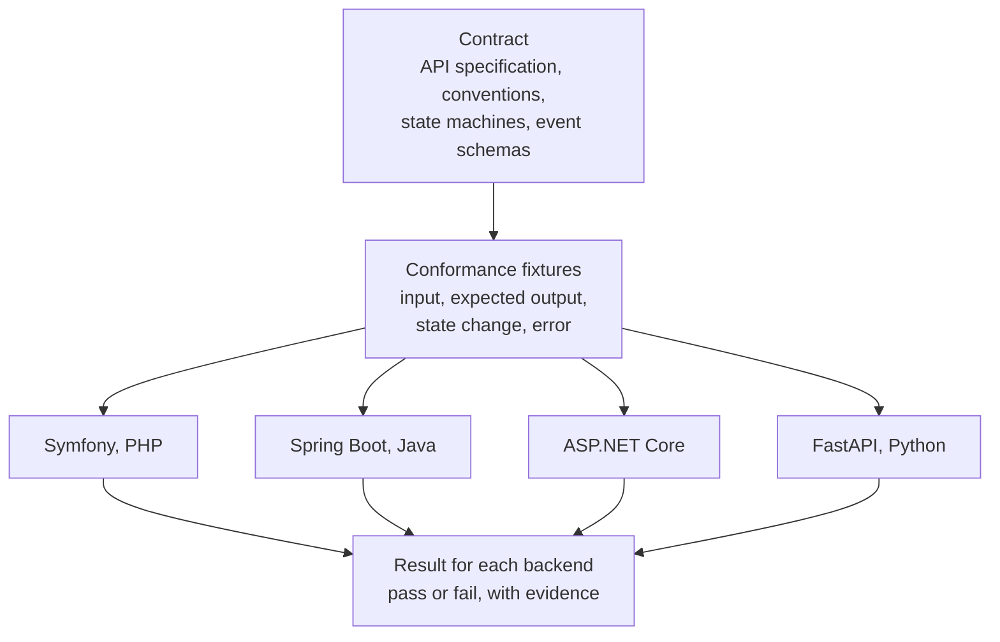

# Contract-first development

**Status:** this page describes a planned approach. The contracts are not written yet and no conformance test exists yet. The contracts are planned for publication at roadmap milestone M1. See the [roadmap](https://github.com/Faka-iAction/docs-public/blob/main/ROADMAP.md).

## What "contract-first" means here

A **contract** is a precise, machine-readable description of how a system behaves at its boundary: what requests it accepts, what it returns, what errors it gives, and what events it emits.

**Contract-first** means the contract is written and agreed before the code. Implementations are then written to match the contract. The opposite is code-first, where the code is written and a description is generated from it afterwards.

In FAKA iAction the contract is a set of files in this repository. It is not owned by any one implementation. If an implementation and the contract disagree, the implementation is wrong.

## What the contract will contain

| Part | What it defines |
|---|---|
| **API specification** | Every operation, written in OpenAPI, a standard format for describing HTTP APIs. Requests, responses, status codes and authentication, under a versioned base path (`/api/v1`). |
| **Shared conventions** | Rules every operation follows: one error format, idempotency, pagination, correlation identifiers and the representation of money. |
| **State machines** | The allowed states and transitions for each Action type, and the canonical states for payment and settlement. |
| **Event schemas** | The standard envelope for every event, and the schema of each event's payload. |
| **Conformance fixtures** | Language-neutral test cases that any implementation can be run against. |

Some of the conventions in more detail:

- **One error format.** Every error has the same shape, so a client handles errors in one place.
- **Idempotency.** An operation that must not happen twice, such as creating a payment, accepts an idempotency key. Sending the same request again with the same key returns the original result and does not repeat the effect. This matters on mobile networks, where a client often cannot tell whether a request arrived.
- **Money.** Amounts are whole numbers of the smallest unit of the currency, together with a currency code. Floating-point amounts are not used anywhere.
- **Versioning.** A change that would break existing clients goes into a new version of the API (`/api/v2`), not into the existing one.
- **Events.** Every event carries an identifier, a type, a schema version, the identifier and type of the thing it concerns, correlation and causation identifiers, a producer and a timestamp. Payloads carry the minimum a consumer needs.

## Why four backends share one contract

FAKA iAction is planned to have four backend implementations of the same API:

1. Symfony (PHP) — the reference implementation, and the first in the plan;
2. Spring Boot (Java);
3. ASP.NET Core (C#);
4. FastAPI (Python).

These are four implementations of one system. They share one database and one schema. A client must be able to talk to any of them without changing what it sends or what it expects back.

That only works if the contract sits outside all four:

- **A contract inside one codebase is not a contract.** If the specification were generated from the Symfony code, the other three would be copying Symfony's behaviour, including its accidents. With a separate contract, all four are measured against the same thing, and Symfony can be wrong too.
- **"Works the same" has to be checkable.** Four teams reading the same prose would produce four slightly different systems. A machine-readable contract with executable tests removes the interpretation.
- **Clients depend on the contract, not on a backend.** The mobile app is written against the contract. It does not know or care which backend answers.
- **The contract is the place where a change is agreed.** A change to behaviour starts as a change to the contract. Only then is it implemented.

The order of work follows from this. The contract comes first. The Symfony implementation will be written against it and used in a pilot. The other three will follow, written against a contract that has met real use.

One thing the contract does not cover is the database schema. The schema has a single owner: the Symfony implementation is the only one that creates and runs migrations. The other three map onto the existing schema.

## How conformance tests will work

A **conformance test** checks one implementation against the contract. The tests are language-neutral: they are data, not code in any backend's language. A small runner sends the requests to whichever backend is under test.

Each fixture states four things:

1. **Input** — the request, and the state the system starts in.
2. **Expected output** — the response body and status.
3. **Expected state change** — what must be different afterwards, for example an Action moving to a new state or a ledger entry being added.
4. **Expected error** — for the failing cases, the exact error the contract requires.

The same suite is run against every backend. The areas it will cover:

- request and response schemas;
- validation;
- authentication and authorisation, including the narrow permissions of a guest;
- error semantics;
- idempotency, including a repeated request and a repeated provider notification;
- lifecycle transitions, including transitions that must be refused;
- behaviour against the shared database;
- financial safety rules, for example that the ledger balances after every scenario and that a retried refund is not paid twice.

Two rules govern how results are used:

- **A matching status code is not proof.** Two backends can both return "200 OK" and do different things. A fixture checks the state change and the error, not only the status.
- **Status is tracked per backend.** For each capability, each backend is recorded as specified, implemented, tested, deferred or not applicable, with a link to evidence. A capability is not called complete across the project because it works in one backend.

There are two kinds of contract test, and they answer different questions:

| Kind | Question |
|---|---|
| API contract tests | Does this backend's API match the specification? |
| Event contract tests | Do the events this backend emits match the event schemas, and can consumers read them across schema versions? |

The web pages and the API are two entry points to the same business rules in the Symfony implementation. Contract tests will also check that both entry points reach the same outcome and the same authorisation decision.

## What will be published, and when

| When | What |
|---|---|
| Now (milestone M0) | This explanation. |
| Milestone M1 | The API specification and the event schemas at a tagged version, with a walkthrough of the conventions. |
| Later milestones | Conformance fixtures and updates to the contract as capabilities are added, each tied to a tagged version. |

The published contract is a public edition. Examples that contain private data, and fields that relate to fraud and risk controls, are left out of it by design.

Until milestone M1, this repository contains no contract files. Nothing here can be used to build a client yet.

## Further reading

- [Architecture overview](https://github.com/Faka-iAction/architecture-public/blob/main/OVERVIEW.md) — how the contract fits with the shared database, the clients and events.
- [Design decisions](https://github.com/Faka-iAction/architecture-public/blob/main/DECISIONS.md) — including the decision that one implementation owns the schema.
- [Glossary](https://github.com/Faka-iAction/docs-public/blob/main/GLOSSARY.md) — the project's vocabulary.
