# FAKA iAction — MVP1 Logical Domain Model

**Status:** Draft for review. Milestone M1 contract deliverable. Revised 2026-10-15 with API contract `1.0.0-alpha.2`. Part of this model now exists as Doctrine migrations in `api-symfony`; Section 16 records those tables as built and where they differ from this model. Nothing here is claimed as tested in production.
**Source of truth:** Master Architecture v2.10 (approved 2026-10-13). Where this file and the architecture disagree, the architecture wins.
**Also read:** TIS v0.3 (review draft) Sections 7, 8 and 9, and `state-machines.md` in this folder.
**Product decisions:** the product decision record (not published). Decisions 1 to 25 are applied here and are stated as fact, with the decision number. Decisions 1 to 16 are in architecture v2.10; decisions 17 to 25 are not yet in an approved architecture and are carried in the v2.11 draft.

This is a logical model. It is not a physical schema. Section 41 of the architecture says no physical schema is frozen yet, and the table count is only fixed after this model and the API contracts are agreed.

## 1. How to read this file

### 1.1 Labels

| Label | Meaning |
|---|---|
| **(P)** | A proposal. The architecture does not define this value, name or rule. It is listed again under "Open questions". Do not treat it as decided. |
| **Req** | The attribute must have a value. |
| **Opt** | The attribute may be empty. |
| **Cond** | Required only in the stated case. |

Table names are the names used in architecture Section 41. Where this model needs something that Section 41 does not list, the entity is marked **(P) not in Section 41**.

### 1.2 Conventions that apply to every entity

1. **Money** is an integer count of minor units (`money_minor`, signed 64-bit) plus an ISO 4217 currency code (`currency`, 3 letters). No floating point anywhere (TIS 7.2). The MVP1 currency is `ZAR`.
2. **Timestamps** are stored in UTC (`timestamp_utc`, microsecond precision). Provider timestamps are kept as separate attributes where they help reconciliation (TIS 7.2).
3. **Identifiers.** Every entity that an API, URL, QR code, receipt or event can refer to has a `public_id`. It is opaque, not sequential, not guessable and unique. Internal keys (`id`) never leave the database. The exact format of both is an open question (OQ-01).
4. **Every entity has `created_at`.** Mutable entities also have `updated_at`. These are not repeated in the attribute tables.
5. **No wallet.** There is no wallet account, wallet transaction or balance column on any entity. A creator's pending balance is derived from the ledger (Section 6.16 below; architecture 14.2).
6. **Enumerations** are stored as strings. Canonical state names come from the architecture and are used unchanged.
7. **Foreign keys and unique constraints** are listed where they encode a real invariant (TIS 7.2). "Exactly one of A or B" means a check constraint.
8. **Recipient.** "Recipient" is the generic term; a Creator is the only kind of Recipient in MVP1 (architecture 2.3). The model uses `creator_profiles` as the recipient entity and keeps the column name `recipient_creator_profile_id` on transactional entities so that later recipient kinds are not blocked.
9. **Self-managed only.** MVP1 has self-managed profiles only (architecture 52.1). The model must not block the later organisation-managed model (architecture 62.1.1), so the legal payee and payout destination are held on `settlement_profiles`, not on the profile.

### 1.3 Logical types

| Type | Meaning |
|---|---|
| `id` | Internal key. Format open (OQ-01). |
| `public_id` | Opaque public identifier. Format open (OQ-01). |
| `string(n)` | Text up to n characters. |
| `text` | Long text. |
| `int` | Integer. |
| `bool` | True or false. |
| `enum` | One value from a closed list. |
| `money_minor` | Signed integer, minor units. |
| `currency` | ISO 4217 code, 3 letters. |
| `country` | ISO 3166-1 alpha-2 code. |
| `language` | BCP 47 language tag. |
| `timestamp_utc` | UTC timestamp. |
| `json` | Structured value, validated by the application. |
| `hash` | One-way hash of a secret. The secret itself is never stored. |

## 2. Entity list

Groups follow architecture Section 41.1. The classification column uses the three classes that Section 41 requires. The classification of each table is itself a proposal for the schema review, except where the architecture states the phase.

| Group | Entity (table) | MVP1 class |
|---|---|---|
| Identity and Access | `members` | Required |
| | `member_identifiers` | Required. Not in Section 41; needed by decision 10 |
| | `member_credentials` | Required |
| | `member_capabilities` | Required |
| | `creator_profiles` | Required |
| | `creator_handle_history` | Required. Not in Section 41; needed by decision 11 |
| | `creator_categories` | Required |
| | `creator_languages` | Required |
| | `member_sessions` | Required |
| | `consent_records` | Required |
| | `policy_documents` | Required |
| | `policy_acceptances` | Required |
| | `guest_sessions` | Required |
| Creator and Actions | `creator_actions` | Required |
| | `creator_action_configs` | Required |
| | `action_options` | Required |
| | `creator_playlists` | Required |
| | `playlist_items` | Required |
| | `action_participants` (the Action instance) | Required |
| | `action_requests` | Required |
| | `action_votes` | Required |
| | `action_bids` | Required |
| | `action_tips` | Required |
| | `action_messages` | Required |
| | `action_queue_entries` | Required |
| | `qr_resources` | Required |
| | `state_transitions` | Required. **(P) not in Section 41** |
| Social/Discovery | `creator_follows` | Required |
| | `creator_public_links` | Required |
| | `creator_categories_map` | Required |
| | `creator_locations` | Required |
| | `creator_verifications` | Required |
| | search/index metadata | No table in MVP1 (P). MySQL full-text index on existing tables |
| Payments and Ledger | `payment_intents` | Required |
| | `payment_transactions` | Required |
| | `payment_webhooks` | Required |
| | `refunds` | Required |
| | `disputes` | Required |
| | `settlements` | Required |
| | `settlement_profiles` | Required |
| | `payout_transactions` | Required |
| | `cash_receipts` | Required |
| | `reconciliation_runs` | Required |
| | `reconciliation_exceptions` | Required |
| | `ledger_entries` | Required |
| | `ledger_accounts` | Required |
| | `revenue_rules` | Required |
| | `currency_rates` | Not created in MVP1 (P). One currency at launch |
| Referrals | `referral_codes` | Required |
| | `referral_attributions` | Required |
| | `referral_rewards` | Required |
| | `referral_reversals` | Required |
| Country and Localization | `countries` | Required |
| | `country_configurations` | Required |
| | `country_config_overrides` | Foundation |
| | `languages` | Required |
| | `translations` | Not created in MVP1 (P). See OQ-27 |
| Notifications and Communication | `communication_channels` | Required |
| | `notification_preferences` | Required |
| | `notification_templates` | Required |
| | `notifications` | Required |
| | `notification_deliveries` | Required |
| Trust, Safety and Support | `reports` | Required |
| | `moderation_cases` | Required |
| | `moderation_actions` | Required |
| | `member_blocks` | Required |
| | `risk_decisions` | Required |
| | `transaction_limits` | Required |
| | `support_tickets` | Required |
| | `support_messages` | Required |
| | `audit_logs` | Required |
| | `admin_role_grants` | Required. **Not in Section 41**; built in `api-symfony` (Section 16.8) |
| Marketing and Sponsorship | `starter_pack_templates` | Required |
| | `generated_starter_packs` | Required |
| | `generated_assets` | Required |
| | `advertisements`, `advertising_campaigns`, `sponsors/advertisers`, `sponsorships`, `campaign_events` | Not created in MVP1 (later phase: architecture 12.8.1, 52.3) |
| Event Infrastructure | `outbox_events` | Required |
| | `processed_events` | Required |
| | `idempotency_keys` | Required |
| | event reconciliation records | Not created in MVP1 (P). "Where required" in Section 41 |
| Organisations | `organisations`, `organisation_members`, `profile_representations` | **Not created in MVP1** (architecture 41.1) |
| SEO / Music-DJ Vertical | `live_sessions` | Foundation (P). See OQ-08 |
| | `live_external_links` | Foundation (P). See OQ-08 |
| | `provider_sources`, `provider_imports`, `provider_profiles`, `provider_claims`, `provider_removals` | Not created in MVP1 (later phase: architecture 12.8.1 "Imported provider listings and claiming") |

Count: 77 entities are detailed below (76 in the first draft, plus `admin_role_grants`, added from the build). Section 41 targets about 50 to 55; the difference is a matter for the schema review (OQ-34).

## 3. Identity and Access

### 3.1 `members`

**Purpose:** One registered FAKA Member account; a member is never permanently a "fan" or a "creator" (architecture 4.1).

| Attribute | Type | Req | Notes |
|---|---|---|---|
| `id` | id | Req | Internal key |
| `public_id` | public_id | Req | |
| `display_name` | string(120) | Req | |
| `country_code` | country | Req | FK `countries` |
| `preferred_language` | language | Req | FK `languages` |
| `status` | enum | Req | `ACTIVE`, `SUSPENDED`, `CLOSED` (P) |
| `closed_at` | timestamp_utc | Opt | Account closure (architecture 38) |

**Relationships:** has one or many `member_identifiers`; has many `member_credentials`, `member_capabilities`, `member_sessions`; has zero or one `creator_profiles` (decision 12); has zero or one `settlement_profiles` (OQ-17); has one `referral_codes`.

**Invariants:**
- `public_id` unique.
- A member has at least one `member_identifiers` row. Email addresses, phone numbers and social logins are held there, not on this entity (decision 10).
- There is no `account_type` column and no balance column (architecture 4.2, 14.2).

### 3.2 `member_identifiers`

**Purpose:** One identifier a member can sign in with: an email address, a phone number or a social login (decision 10). A member can hold several.

Not in Section 41. Sign-in is by email, by phone number and by social login (decision 10), so one member needs several identifiers, each with its own verification state.

| Attribute | Type | Req | Notes |
|---|---|---|---|
| `id` | id | Req | |
| `public_id` | public_id | Req | So a member can list, link and unlink identifiers |
| `member_id` | id | Req | FK `members` |
| `type` | enum | Req | `EMAIL`, `PHONE`, `SOCIAL` (decision 10) |
| `provider` | string(40) | Cond | Required for `SOCIAL`; empty otherwise. Which providers are supported is open (OQ-37) |
| `value` | string(254) | Req | `EMAIL`: the address, normalised to lower case. `PHONE`: E.164. `SOCIAL`: the provider's subject for the account |
| `verification_state` | enum | Req | `UNVERIFIED`, `VERIFIED` (P). Whether an identifier must be verified before it can be used to sign in is open (OQ-38) |
| `verified_at` | timestamp_utc | Opt | |
| `provider_email` | string(254) | Opt | `SOCIAL` only: the email the provider reports. Kept so that account linking is possible (OQ-40) |
| `provider_email_verified` | bool | Opt | `SOCIAL` only: whether the provider says that email is verified |
| `is_primary_contact` | bool | Req | Marks the email or phone used for receipts and notifications (P) |
| `linked_at` | timestamp_utc | Req | |
| `last_used_at` | timestamp_utc | Opt | |

**Relationships:** belongs to one `members`.

**Invariants:**
- `public_id` unique.
- Unique (`type`, `provider`, `value`): one email address, one phone number or one social account belongs to at most one member. Email is compared case-insensitively.
- `provider` is present exactly when `type` is `SOCIAL`.
- A member always keeps at least one identifier; the last one cannot be unlinked.
- A `SOCIAL` identifier needs no `member_credentials` row. A member who signs in only by social login has no password (decision 10).
- A social login is never linked to an existing member on the strength of an unverified provider email. The linking rule itself is open (OQ-40).
- One-time codes are short-lived secrets and are not stored on this entity.

### 3.3 `member_credentials`

**Purpose:** A secret a member holds for sign-in, kept apart from the member and from the identifiers so that it can be added, changed or revoked.

A member is not required to have one. Whether email sign-in uses a password, a one-time code or either is open (OQ-39).

| Attribute | Type | Req | Notes |
|---|---|---|---|
| `id` | id | Req | |
| `member_id` | id | Req | FK `members` |
| `type` | enum | Req | `PASSWORD` (P, OQ-39) |
| `secret_hash` | hash | Req | |
| `last_used_at` | timestamp_utc | Opt | |
| `revoked_at` | timestamp_utc | Opt | |

**Invariants:** FK to `members`. At most one credential of a type per member that is not revoked. No plain-text secret is stored. A member with zero rows here is valid (a social-only or one-time-code-only member).

### 3.4 `member_capabilities`

**Purpose:** Records what a member can do (fan, creator) without a rigid account type (architecture 4.2).

| Attribute | Type | Req | Notes |
|---|---|---|---|
| `id` | id | Req | |
| `member_id` | id | Req | FK `members` |
| `capability` | enum | Req | `FAN`, `CREATOR` (P). Architecture 39 suggests the states `MEMBER`, `CREATOR`, `CREATOR_VERIFIED`; see OQ-04 |
| `status` | enum | Req | `ACTIVE`, `RESTRICTED`, `REVOKED` (P) |
| `granted_at` | timestamp_utc | Req | |
| `revoked_at` | timestamp_utc | Opt | |

**Invariants:** FK to `members`. Unique (`member_id`, `capability`). Payout eligibility is not a capability; it is held on `settlement_profiles` (architecture 39).

### 3.5 `creator_profiles`

**Purpose:** The public creator identity at `/@handle`; the Recipient of every MVP1 Action.

| Attribute | Type | Req | Notes |
|---|---|---|---|
| `id` | id | Req | |
| `public_id` | public_id | Req | |
| `member_id` | id | Req | FK `members`. The owning creator |
| `handle` | string(40) | Req | The `@creator` part of the URL |
| `display_name` | string(120) | Req | |
| `bio` | text | Opt | |
| `profile_image_ref` | string(255) | Opt | Storage reference, not a URL to a third party |
| `primary_category_id` | id | Opt | FK `creator_categories` |
| `country_code` | country | Req | FK `countries` |
| `management_type` | enum | Req | `SELF_MANAGED` only in MVP1. Kept so the later managed model is not blocked |
| `status` | enum | Req | `DRAFT`, `PUBLISHED`, `SUSPENDED`, `CLOSED` (P) |
| `published_at` | timestamp_utc | Opt | |

**Relationships:** belongs to one `members`; has many `creator_handle_history`, `creator_actions`, `creator_playlists`, `qr_resources`, `creator_follows`, `creator_public_links`, `creator_languages`, `creator_locations`, `creator_verifications`.

**Invariants:**
- `public_id` unique. `handle` unique, compared case-insensitively.
- FK to `members`. Unique `member_id`: one creator profile per member (decision 12).
- `management_type` must be `SELF_MANAGED` in MVP1 (check constraint).
- A handle rename must not break old links or printed QR codes. QR codes are safe because they encode `qr_resources.short_code`, not the handle (architecture 9). An old `/@handle` stays reserved and redirects to the new one (decision 11); see `creator_handle_history`.
- `handle` equals the current row for this profile in `creator_handle_history`.

### 3.6 `creator_handle_history`

**Purpose:** Every handle a creator profile holds or has held, so that an old `/@handle` stays reserved and redirects to the current one (decision 11).

Not in Section 41.

| Attribute | Type | Req | Notes |
|---|---|---|---|
| `id` | id | Req | |
| `creator_profile_id` | id | Req | FK `creator_profiles` |
| `handle` | string(40) | Req | Stored in the same normalised form as `creator_profiles.handle` |
| `is_current` | bool | Req | True for the handle in use now |
| `assigned_at` | timestamp_utc | Req | |
| `replaced_at` | timestamp_utc | Opt | Set when the creator renames away from this handle |

**Relationships:** belongs to one `creator_profiles`.

**Invariants:**
- `handle` unique across this whole table, compared case-insensitively. Because current and old handles are both here, no profile can take a handle that another profile holds or has held. An old handle is not released for others to claim.
- Exactly one row per profile has `is_current` true.
- Rows are never deleted. A rename marks the old row replaced and adds a new current row, in the same transaction as the change to `creator_profiles.handle`.
- A request for an old handle redirects to the profile's current handle.

### 3.7 `creator_categories`

**Purpose:** The list of creator types (DJ, musician, radio presenter and so on) used for discovery and Starter Pack generation.

| Attribute | Type | Req | Notes |
|---|---|---|---|
| `id` | id | Req | |
| `code` | string(40) | Req | Stable key, for example `dj` |
| `name_key` | string(120) | Req | Translation key |
| `parent_id` | id | Opt | FK `creator_categories` |
| `status` | enum | Req | `ACTIVE`, `INACTIVE` (P) |

**Invariants:** `code` unique. Self-FK on `parent_id`.

### 3.8 `creator_languages`

**Purpose:** The languages a creator works in, shown on the profile.

| Attribute | Type | Req | Notes |
|---|---|---|---|
| `creator_profile_id` | id | Req | FK `creator_profiles` |
| `language_code` | language | Req | FK `languages` |

**Invariants:** Unique (`creator_profile_id`, `language_code`).

### 3.9 `member_sessions`

**Purpose:** The durable record of a member's signed-in sessions and API refresh tokens, so they can be listed and revoked.

| Attribute | Type | Req | Notes |
|---|---|---|---|
| `id` | id | Req | |
| `member_id` | id | Req | FK `members` |
| `kind` | enum | Req | `WEB`, `API` (architecture 43.1 keeps the two apart) |
| `token_hash` | hash | Req | Session identifier or refresh token, hashed |
| `issued_at` | timestamp_utc | Req | |
| `expires_at` | timestamp_utc | Req | |
| `revoked_at` | timestamp_utc | Opt | |
| `rotated_from_id` | id | Opt | FK `member_sessions`. Refresh-token rotation |
| `client_info` | json | Opt | Device and user agent, minimal |

**Invariants:** `token_hash` unique. FK to `members`. Valkey holds live web session data (architecture 52.2); how that splits from this table is OQ-06.

### 3.10 `guest_sessions`

**Purpose:** A limited principal for a visitor who participates without registering (architecture 5, 43.1).

| Attribute | Type | Req | Notes |
|---|---|---|---|
| `id` | id | Req | |
| `public_id` | public_id | Req | Used as the receipt/status reference |
| `token_hash` | hash | Req | The guest's bearer secret |
| `contact_email` | string(254) | Opt | Only for the receipt, if the guest gives it |
| `contact_phone_e164` | string(16) | Opt | |
| `country_code` | country | Opt | FK `countries` |
| `language_code` | language | Opt | FK `languages` |
| `expires_at` | timestamp_utc | Req | |
| `converted_member_id` | id | Opt | FK `members`. Set only by an explicit act of the member |
| `converted_at` | timestamp_utc | Opt | |

A guest session lasts 30 days and is renewed on use (decision 23): `expires_at` moves forward on each use. As built, see Section 16.10.

**Invariants:**
- `public_id` unique. `token_hash` unique.
- Creating a guest session never creates a `members` row (architecture 5.1).
- Conversion links existing Actions and payments to the member; it never copies or re-creates them (TIS 8.3). The original guest reference stays on each record.

### 3.11 `consent_records`

**Purpose:** Evidence of each consent given or withdrawn by a member or guest.

| Attribute | Type | Req | Notes |
|---|---|---|---|
| `id` | id | Req | |
| `member_id` | id | Cond | FK `members` |
| `guest_session_id` | id | Cond | FK `guest_sessions` |
| `consent_type` | enum | Req | The list of consent types is not defined (OQ-07) |
| `granted` | bool | Req | False records a withdrawal |
| `policy_document_id` | id | Opt | FK `policy_documents`. The version shown |
| `captured_at` | timestamp_utc | Req | |
| `source` | string(40) | Req | For example `web`, `mobile` |

**Invariants:** Exactly one of `member_id` or `guest_session_id`. Rows are append-only: a withdrawal is a new row.

### 3.12 `policy_documents`

**Purpose:** Versioned, effective-dated legal documents (architecture 30.2).

| Attribute | Type | Req | Notes |
|---|---|---|---|
| `id` | id | Req | |
| `public_id` | public_id | Req | |
| `type` | enum | Req | For example `TERMS_OF_SERVICE`, `PRIVACY_POLICY`, `CREATOR_AGREEMENT`, `REFUND_POLICY`, `PAYMENT_SETTLEMENT_TERMS` (from architecture 30.2) |
| `version` | string(20) | Req | |
| `country_code` | country | Opt | Empty means platform baseline |
| `language_code` | language | Req | FK `languages` |
| `content_ref` | string(255) | Req | Storage reference to the exact text |
| `content_hash` | string(64) | Req | Proves which text was shown |
| `acceptance_required` | bool | Req | |
| `status` | enum | Req | `DRAFT`, `PUBLISHED`, `RETIRED` (P) |
| `effective_from` | timestamp_utc | Req | |
| `effective_until` | timestamp_utc | Opt | |

**Invariants:** Unique (`type`, `country_code`, `language_code`, `version`). A published document is never edited; a change is a new version.

### 3.13 `policy_acceptances`

**Purpose:** Evidence that a member or guest accepted a specific document version.

| Attribute | Type | Req | Notes |
|---|---|---|---|
| `id` | id | Req | |
| `policy_document_id` | id | Req | FK `policy_documents` |
| `member_id` | id | Cond | FK `members` |
| `guest_session_id` | id | Cond | FK `guest_sessions` |
| `action_participant_id` | id | Opt | FK `action_participants`. The guest transaction reference (architecture 30.2) |
| `accepted_at` | timestamp_utc | Req | |

**Invariants:** Exactly one of `member_id` or `guest_session_id`. Unique (`policy_document_id`, `member_id`) for members. Append-only.

### 3.14 Diagram

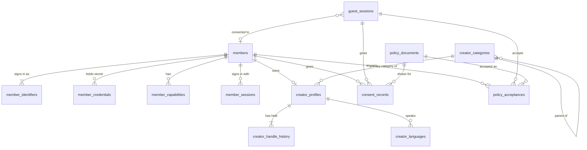

## 4. Creator and Actions

Two different things are both called "Action" in everyday speech. This model keeps them apart, as the architecture does (Section 8; TIS 8.1):

- **Creator Action** (`creator_actions`): the definition a creator publishes, for example "Request a song".
- **Participant Action** or **Action instance** (`action_participants`): one participant's interaction with that definition, for example one song request.

### 4.1 `creator_actions`

**Purpose:** A configurable interaction published by a creator; one of the five MVP1 types.

| Attribute | Type | Req | Notes |
|---|---|---|---|
| `id` | id | Req | |
| `public_id` | public_id | Req | |
| `creator_profile_id` | id | Req | FK `creator_profiles` |
| `action_type` | enum | Req | `REQUEST`, `VOTE`, `BID`, `SHOUT_OUT`, `TIP` (architecture 7) |
| `slug` | string(60) | Req | The `action` part of `/@creator/action` |
| `title` | string(120) | Req | |
| `description` | text | Opt | |
| `state` | enum | Req | `DRAFT`, `PUBLISHED`, `ACTIVE`, `PAUSED`, `EXPIRED`, `DISABLED` (architecture 8) |
| `current_config_id` | id | Opt | FK `creator_action_configs`. Empty only in `DRAFT` |
| `starts_at` | timestamp_utc | Opt | |
| `ends_at` | timestamp_utc | Opt | |
| `live_session_id` | id | Opt | FK `live_sessions` (OQ-08) |
| `ranking_version` | int | Req | For `BID` only: increases each time ranks are recalculated (OQ-12) |

**Relationships:** belongs to one `creator_profiles`; has many `creator_action_configs`, `action_options`, `action_participants`, `qr_resources`.

**Invariants:**
- `public_id` unique. Unique (`creator_profile_id`, `slug`).
- `action_type` never changes after creation.
- A paid `VOTE` cannot be configured in MVP1 (architecture 7.3, 12.8.1).

### 4.2 `creator_action_configs`

**Purpose:** The rules of a Creator Action at a point in time, so that every participant Action can show the exact price, deadline and terms it was made under.

Versioning is decided (decision 19, OQ-09): editing a live Creator Action creates a new configuration version, which applies to new participants only. The architecture requires that the deadline is shown before payment (Section 8.1) and that the bid screen states the rules before payment (Section 7.4.1); a config that can be edited in place cannot prove what was shown.

| Attribute | Type | Req | Notes |
|---|---|---|---|
| `id` | id | Req | |
| `creator_action_id` | id | Req | FK `creator_actions` |
| `version` | int | Req | Starts at 1 |
| `payment_requirement` | enum | Req | `FREE`, `PAID` (P) |
| `currency` | currency | Cond | Required when `PAID` |
| `price_minor` | money_minor | Cond | Fixed price: `REQUEST`, `SHOUT_OUT` |
| `min_bid_minor` | money_minor | Cond | `BID`. A bid need not beat the highest bid; any amount at or above this, in increment steps, joins the ranking (decision 1) |
| `bid_increment_minor` | money_minor | Cond | `BID`. The step above the minimum, and the least amount of a raise (decision 1) |
| `ranking_rule` | enum | Cond | `BID`. Default `HIGHEST_TOTAL_FIRST`. Other rules are not defined (OQ-11) |
| `max_bids_per_participant` | int | Opt | `BID` ("maximum participant bids", architecture 7.4) |
| `tip_min_minor` | money_minor | Cond | `TIP` |
| `tip_max_minor` | money_minor | Cond | `TIP` |
| `tip_suggested_minor` | json | Opt | `TIP`. List of suggested amounts |
| `voting_method` | enum | Cond | `VOTE`. Values are not defined (OQ-10) |
| `allowed_payment_methods` | json | Cond | Which methods this Action accepts (architecture 12.5.3 step 3) |
| `cash_in_person_enabled` | bool | Req | Must be false unless the profile is self-managed and policy allows cash for this type and country (architecture 12.5.3). Always false for `BID` in MVP1 (decision 3) |
| `guest_participation_allowed` | bool | Req | Architecture 5 |
| `approval_required` | bool | Req | Creator approval before fulfilment |
| `fulfilment_deadline_rule` | enum | Cond | Required when `PAID`, except `TIP`. Optional for a free Request or Shout-out; when set, a free Action's deadline follows it, with no payment effect (decision 24). `AT_ACTION_END`, `AT_SESSION_END`, `FIXED_PERIOD_AFTER_PAYMENT` (P, from the examples in architecture 8.1) |
| `fulfilment_period_seconds` | int | Cond | For `FIXED_PERIOD_AFTER_PAYMENT` |
| `quantity_limit` | int | Opt | |
| `duplicate_policy` | enum | Opt | For example duplicate requests disabled (architecture 7.2). Values not defined (OQ-10) |
| `audience_limit` | json | Opt | Not defined further by the architecture (OQ-10) |
| `options_source` | enum | Opt | `ACTION_OPTIONS`, `PLAYLIST` (P) |
| `playlist_id` | id | Opt | FK `creator_playlists` |
| `message_enabled` | bool | Req | Shout-out body, optional Tip message |
| `message_max_length` | int | Cond | |
| `moderation_mode` | enum | Cond | Values not defined (OQ-10) |
| `message_visibility` | enum | Opt | `SHOUT_OUT` (architecture 7.5). Values not defined (OQ-10) |
| `display_duration_seconds` | int | Opt | `SHOUT_OUT` |
| `custom_field_enabled` | bool | Req | Architecture 7.6 |
| `custom_field_label` | string(120) | Cond | |
| `custom_field_max_length` | int | Cond | |
| `notification_rules` | json | Opt | |
| `created_by_member_id` | id | Req | FK `members` |

**Invariants:**
- Unique (`creator_action_id`, `version`). A config row is never updated after any `action_participants` row refers to it.
- All amounts in one config use the same `currency`.
- `min_bid_minor`, `bid_increment_minor`, `price_minor`, `tip_min_minor` are greater than zero when present; `tip_max_minor` is not below `tip_min_minor`.
- The resolved fulfilment deadline must fall inside the cool-off period (architecture 8.1). This is checked by the application against country configuration when the config is saved and again when a payment is confirmed; it cannot be a database constraint.
- "Settlement behaviour" is listed as configurable in architecture 7.1 but has no attribute here; see OQ-33.

### 4.3 `action_options`

**Purpose:** A choice the creator offers on a Vote or a Request.

| Attribute | Type | Req | Notes |
|---|---|---|---|
| `id` | id | Req | |
| `public_id` | public_id | Req | |
| `creator_action_id` | id | Req | FK `creator_actions` |
| `label` | string(200) | Req | |
| `position` | int | Req | Display order |
| `playlist_item_id` | id | Opt | FK `playlist_items` |
| `status` | enum | Req | `AVAILABLE`, `UNAVAILABLE` (P) |

**Invariants:** Unique (`creator_action_id`, `position`). Vote totals are counted from `action_votes`; no counter column is authoritative.

### 4.4 `creator_playlists`

**Purpose:** A creator-defined list (for example a DJ's set) that a Request can be limited to (architecture 7.2).

| Attribute | Type | Req | Notes |
|---|---|---|---|
| `id` | id | Req | |
| `public_id` | public_id | Req | |
| `creator_profile_id` | id | Req | FK `creator_profiles` |
| `name` | string(120) | Req | |
| `status` | enum | Req | `ACTIVE`, `ARCHIVED` (P) |

**Invariants:** Unique (`creator_profile_id`, `name`).

### 4.5 `playlist_items`

**Purpose:** One selectable entry in a playlist.

| Attribute | Type | Req | Notes |
|---|---|---|---|
| `id` | id | Req | |
| `public_id` | public_id | Req | |
| `playlist_id` | id | Req | FK `creator_playlists` |
| `title` | string(200) | Req | |
| `artist` | string(200) | Opt | |
| `position` | int | Req | |
| `available` | bool | Req | |

**Invariants:** Unique (`playlist_id`, `position`). Music-service integrations are out of MVP1 scope here (architecture 11.2).

### 4.6 `action_participants` — the Participant Action (Action instance)

**Purpose:** One participant's interaction with one Creator Action; the common record shared by all five types (TIS 8.1). It carries the Action state.

Section 41 has no table named for the Action instance. This model uses `action_participants` for it. Renaming it is OQ-13.

| Attribute | Type | Req | Notes |
|---|---|---|---|
| `id` | id | Req | |
| `public_id` | public_id | Req | The reference shown on receipts and status pages |
| `creator_action_id` | id | Req | FK `creator_actions` |
| `creator_action_config_id` | id | Req | FK `creator_action_configs`. The rules that applied |
| `action_type` | enum | Req | Copy of the Creator Action's type |
| `recipient_creator_profile_id` | id | Req | FK `creator_profiles` |
| `member_id` | id | Cond | FK `members` |
| `guest_session_id` | id | Cond | FK `guest_sessions` |
| `state` | enum | Req | From the common vocabulary in architecture 62.6; see `state-machines.md` |
| `state_version` | int | Req | Increases on every transition (TIS 8.5). As built it is **not** what orders events or locks rows: see `lock_version` and Section 16.11 |
| `payment_method` | enum | Req | `FREE`, `CASH_IN_PERSON`, or an online method. Online method names are not defined (OQ-14) |
| `amount_minor` | money_minor | Cond | The amount due for this Action. Empty when free. For a Bid, the bidder's current total |
| `currency` | currency | Cond | |
| `fulfilment_deadline_at` | timestamp_utc | Cond | Required for a paid Action other than a Tip, from the moment it is submitted (architecture 8.1). Set for a free Action too when its config has a deadline rule (decision 24) |
| `custom_field_value` | text | Opt | The typed response to the custom field |
| `live_session_id` | id | Opt | FK `live_sessions` |
| `submitted_at` | timestamp_utc | Opt | |
| `accepted_at` | timestamp_utc | Opt | |
| `fulfilled_at` | timestamp_utc | Opt | The creator's attestation time |
| `fulfilled_by_member_id` | id | Opt | FK `members` |
| `closed_at` | timestamp_utc | Opt | When a terminal state was reached |
| `close_reason` | string(60) | Opt | Machine-readable reason |
| `idempotency_key` | string(120) | Req | The client's submission key |

**Relationships:** belongs to one `creator_actions` and one `creator_action_configs`; has exactly one type row (`action_requests`, `action_votes`, `action_bids` or `action_tips`; a Shout-out's type row is `action_messages`); has zero or many `payment_intents` (more than one only for a raised bid or a retried payment); has zero or one `cash_receipts`; has zero or one `action_queue_entries`.

**Invariants:**
- `public_id` unique.
- Exactly one of `member_id` or `guest_session_id`.
- Unique (`creator_action_id`, `idempotency_key`) so a repeated submission returns the first result.
- `action_type` equals the type of the referenced Creator Action.
- There is no refund or dispute state on this entity. Those are payment states (architecture 62.6).
- Payment state is never copied onto this entity; it is read from `payment_intents` or `cash_receipts`.

### 4.7 `action_requests`

**Purpose:** The type-specific part of a Request: what was chosen.

| Attribute | Type | Req | Notes |
|---|---|---|---|
| `action_participant_id` | id | Req | FK `action_participants`. Also the key |
| `action_option_id` | id | Cond | FK `action_options` |
| `playlist_item_id` | id | Cond | FK `playlist_items` |
| `note` | string(500) | Opt | |

**Invariants:** One row per Action instance. At least one of `action_option_id` or `playlist_item_id` (a Request selects something the creator made available; architecture 2.3).

### 4.8 `action_votes`

**Purpose:** The type-specific part of a Vote: which option was chosen.

| Attribute | Type | Req | Notes |
|---|---|---|---|
| `action_participant_id` | id | Req | FK `action_participants`. Also the key |
| `action_option_id` | id | Req | FK `action_options` |

**Invariants:** One row per Action instance. The option belongs to the same Creator Action. The rule that stops a participant voting more than the configured number of times needs a unique constraint; its shape depends on OQ-10 and OQ-15.

### 4.9 `action_bids`

**Purpose:** The type-specific part of a Bid: the bidder's total and current rank (architecture 7.4.1).

| Attribute | Type | Req | Notes |
|---|---|---|---|
| `action_participant_id` | id | Req | FK `action_participants`. Also the key |
| `creator_action_id` | id | Req | FK `creator_actions`. Repeated here for the ranking index |
| `total_confirmed_minor` | money_minor | Req | Sum of this bid's `CONFIRMED` payments (first bid plus raises) |
| `currency` | currency | Req | |
| `current_rank` | int | Opt | 1 is first. Empty before the first payment is confirmed and after the bid leaves the ranking |
| `rank_tiebreak_at` | timestamp_utc | Opt | The confirmed-payment time used for ties (OQ-16) |
| `raise_count` | int | Req | |
| `last_ranked_version` | int | Opt | The `creator_actions.ranking_version` at the last re-rank; makes replays harmless |

**Invariants:**
- One row per Action instance.
- `total_confirmed_minor` equals the sum of the bid's confirmed `payment_intents`. It changes only inside the transaction that confirms a payment (TIS 8.2.1).
- Among bids on the same Creator Action that are still in the ranking, `current_rank` values are 1..n with no gaps and no duplicates. The row or constraint that arbitrates concurrent bids is OQ-12.
- A bid is never removed from the ranking because it was outbid.

### 4.10 `action_tips`

**Purpose:** The type-specific part of a Tip: the voluntary amount.

| Attribute | Type | Req | Notes |
|---|---|---|---|
| `action_participant_id` | id | Req | FK `action_participants`. Also the key |
| `amount_minor` | money_minor | Req | Chosen by the participant, inside the configured minimum and maximum |
| `currency` | currency | Req | |

**Invariants:** One row per Action instance. `amount_minor` greater than zero. A Tip has no fulfilment deadline (architecture 7.7), so `action_participants.fulfilment_deadline_at` is empty.

### 4.11 `action_messages`

**Purpose:** A participant's message: the body of a Shout-out, or the optional message on a Tip.

| Attribute | Type | Req | Notes |
|---|---|---|---|
| `id` | id | Req | |
| `public_id` | public_id | Req | |
| `action_participant_id` | id | Req | FK `action_participants` |
| `body` | text | Req | Length limited by the config |
| `moderation_status` | enum | Req | `PENDING`, `APPROVED`, `REJECTED` (P) |
| `moderated_by_member_id` | id | Opt | FK `members` |
| `moderated_at` | timestamp_utc | Opt | |
| `displayed_at` | timestamp_utc | Opt | |
| `hidden_at` | timestamp_utc | Opt | Built in `api-symfony`, not in the first draft. Set when moderation hides the message after the fact (`ActionMessageHidden`); the Action's state does not change |

Screening: a Shout-out message is screened automatically before submission and reviewed by the creator after; a rejected paid message is refunded in full (decision 22).

**Invariants:** Unique `action_participant_id` (one message per Action instance). A hidden message is never shown publicly. A message is never shown publicly unless `moderation_status` is `APPROVED` or the config needs no moderation.

### 4.12 `action_queue_entries`

**Purpose:** The creator's working queue of accepted Actions, shared by in-person and online sessions (architecture 10.2).

| Attribute | Type | Req | Notes |
|---|---|---|---|
| `id` | id | Req | |
| `action_participant_id` | id | Req | FK `action_participants` |
| `creator_profile_id` | id | Req | FK `creator_profiles` |
| `live_session_id` | id | Opt | FK `live_sessions` |
| `position` | int | Req | |
| `status` | enum | Req | `QUEUED`, `DONE`, `REMOVED` (P) |

**Invariants:** Unique `action_participant_id`. How a bid's rank and a queue position relate is OQ-18.

### 4.13 `qr_resources`

**Purpose:** A short opaque code that the backend resolves to a current destination (architecture 9, 62.8).

| Attribute | Type | Req | Notes |
|---|---|---|---|
| `id` | id | Req | |
| `short_code` | string(16) | Req | The public identifier, as in `/q/7Hk2Pz`. Opaque and not sequential |
| `creator_profile_id` | id | Req | FK `creator_profiles`. The owner |
| `kind` | enum | Req | `STATIC_CREATOR`, `ACTION`, `CAMPAIGN`, `LIVE_SESSION` (from architecture 9). Later kinds in 62.8 are not created in MVP1 |
| `target_type` | enum | Req | `CREATOR_PROFILE`, `CREATOR_ACTION`, `LIVE_SESSION` (P) |
| `target_creator_action_id` | id | Cond | FK `creator_actions` |
| `target_live_session_id` | id | Cond | FK `live_sessions` |
| `state` | enum | Req | See `state-machines.md` Section 14. State names are a proposal |
| `label` | string(120) | Opt | The creator's own name for the code |
| `attribution_tag` | string(60) | Opt | Attribution parameter (architecture 9) |
| `activated_at` | timestamp_utc | Opt | |
| `expires_at` | timestamp_utc | Opt | Temporary codes |
| `suspended_at` | timestamp_utc | Opt | |
| `revoked_at` | timestamp_utc | Opt | |
| `replaced_by_qr_resource_id` | id | Opt | FK `qr_resources` |

**Invariants:**
- `short_code` unique for ever. A code is never reused, even after revocation.
- The target must belong to the owning creator profile.
- The code holds no handle and no financial instruction. Scanning it authorises nothing (architecture 62.8).
- Scan counts are analytics, kept apart from the ledger (architecture 9). Where scans are stored is OQ-19.

### 4.14 `state_transitions` — (P) not in Section 41

**Purpose:** The history of every state change on an Action, payment, cash receipt, settlement, payout-eligibility state, referral reward and QR resource, with actor, time, reason and correlation ID (TIS 7.1, 7.2, 8.2).

| Attribute | Type | Req | Notes |
|---|---|---|---|
| `id` | id | Req | |
| `entity_type` | enum | Req | Which machine |
| `entity_id` | id | Req | |
| `from_state` | string(60) | Opt | Empty for the first state |
| `to_state` | string(60) | Req | |
| `trigger` | string(60) | Req | |
| `actor_type` | enum | Req | `MEMBER`, `GUEST`, `SYSTEM`, `PROVIDER`, `ADMIN` (P) |
| `actor_id` | id | Opt | |
| `reason` | string(255) | Opt | |
| `correlation_id` | string(64) | Req | |
| `entity_version` | int | Req | The entity's version after the change |
| `occurred_at` | timestamp_utc | Req | |

**Invariants:** Append-only. Unique (`entity_type`, `entity_id`, `entity_version`) so a replayed transition cannot be recorded twice. Whether this is one table, one per machine, or part of `audit_logs` is OQ-20.

### 4.15 Diagram

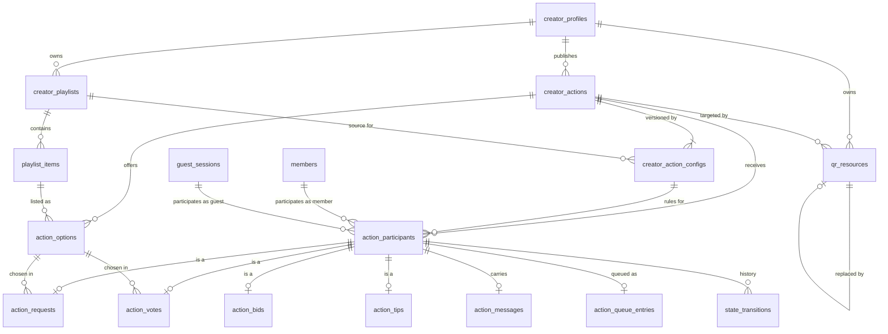

## 5. Social/Discovery

### 5.1 `creator_follows`

**Purpose:** A member following a creator ("Follow" replaces "Favourite"; architecture revision 2.9 item 17).

| Attribute | Type | Req | Notes |
|---|---|---|---|
| `member_id` | id | Req | FK `members` |
| `creator_profile_id` | id | Req | FK `creator_profiles` |
| `followed_at` | timestamp_utc | Req | |

**Invariants:** Unique (`member_id`, `creator_profile_id`). Guests cannot follow (architecture 5.2).

### 5.2 `creator_public_links`

**Purpose:** Social and livestream links shown on the profile (architecture 6).

| Attribute | Type | Req | Notes |
|---|---|---|---|
| `id` | id | Req | |
| `creator_profile_id` | id | Req | FK `creator_profiles` |
| `kind` | enum | Req | `SOCIAL`, `LIVESTREAM`, `WEBSITE` (P) |
| `platform` | string(40) | Opt | For example `youtube` |
| `url` | string(500) | Req | |
| `position` | int | Req | |

**Invariants:** Unique (`creator_profile_id`, `url`).

### 5.3 `creator_categories_map`

**Purpose:** The categories a creator appears under in discovery, beyond the primary one.

| Attribute | Type | Req | Notes |
|---|---|---|---|
| `creator_profile_id` | id | Req | FK `creator_profiles` |
| `creator_category_id` | id | Req | FK `creator_categories` |

**Invariants:** Unique (`creator_profile_id`, `creator_category_id`).

### 5.4 `creator_locations`

**Purpose:** Where a creator works, for discovery (country, and city or area where appropriate).

| Attribute | Type | Req | Notes |
|---|---|---|---|
| `id` | id | Req | |
| `creator_profile_id` | id | Req | FK `creator_profiles` |
| `country_code` | country | Req | FK `countries` |
| `city` | string(120) | Opt | |
| `area` | string(120) | Opt | |
| `is_primary` | bool | Req | |

**Invariants:** At most one primary location per profile. No private address is stored here.

### 5.5 `creator_verifications`

**Purpose:** The record of a creator's verification by the platform, which drives the public verification badge.

| Attribute | Type | Req | Notes |
|---|---|---|---|
| `id` | id | Req | |
| `creator_profile_id` | id | Req | FK `creator_profiles` |
| `status` | enum | Req | `PENDING`, `VERIFIED`, `REJECTED`, `REVOKED` (P) |
| `method` | string(60) | Opt | |
| `decided_by_member_id` | id | Opt | FK `members` (an admin) |
| `decided_at` | timestamp_utc | Opt | |
| `expires_at` | timestamp_utc | Opt | |

**Invariants:** At most one current verification per profile. This is the public badge. It is not payout verification, which is on `settlement_profiles`. Identity documents are not stored here (architecture 62.4).

### 5.6 Search

MVP1 discovery uses MySQL full-text search (architecture 52.2). The proposal is a full-text index on `creator_profiles` (`handle`, `display_name`, `bio`) and no separate search table. Any search index is a rebuildable projection (architecture 42).

### 5.7 Diagram

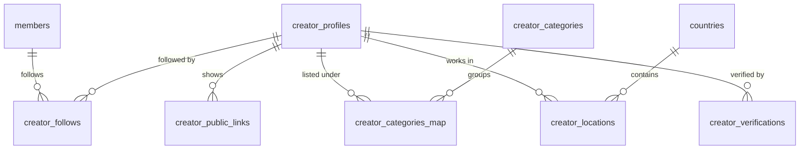

## 6. Payments and Ledger

Three state machines live here and stay separate: Payment, Settlement and payout eligibility. The Action state is a fourth and lives on `action_participants`. They are linked by reference only (architecture 13.3, 62.7).

There are no wallet tables.

### 6.1 `payment_intents`

**Purpose:** One intended PSP charge for one Participant Action; it carries the canonical Payment state.

| Attribute | Type | Req | Notes |
|---|---|---|---|
| `id` | id | Req | |
| `public_id` | public_id | Req | |
| `action_participant_id` | id | Req | FK `action_participants` |
| `purpose` | enum | Req | `INITIAL`, `BID_RAISE` (P) |
| `recipient_creator_profile_id` | id | Req | FK `creator_profiles`. The creator the payment is for (architecture 13.1.1) |
| `payer_member_id` | id | Cond | FK `members` |
| `payer_guest_session_id` | id | Cond | FK `guest_sessions` |
| `amount_minor` | money_minor | Req | For a raise, the difference only |
| `currency` | currency | Req | |
| `method` | enum | Req | An online method (OQ-14). Never `CASH_IN_PERSON` |
| `state` | enum | Req | `CREATED`, `PENDING`, `CONFIRMED`, `FAILED`, `EXPIRED`, `REFUNDED`, `DISPUTED`, `REVERSED` (architecture 13.3) |
| `state_version` | int | Req | |
| `provider_code` | string(40) | Req | Which PSP adapter |
| `provider_reference` | string(120) | Opt | The PSP's payment reference |
| `idempotency_key` | string(120) | Req | |
| `expires_at` | timestamp_utc | Req | Checkout window |
| `confirmed_at` | timestamp_utc | Opt | When FAKA verified the payment. Used for bid ties |
| `provider_confirmed_at` | timestamp_utc | Opt | The provider's own time |
| `cool_off_ends_at` | timestamp_utc | Opt | Set on confirmation from country configuration |
| `platform_fee_minor` | money_minor | Opt | Assessed on confirmation |
| `processing_fee_minor` | money_minor | Opt | PSP fee, borne by the creator |
| `revenue_rule_id` | id | Opt | FK `revenue_rules`. The rule that set the platform fee |
| `failure_code` | string(60) | Opt | |

**Invariants:**
- `public_id` unique. Unique (`provider_code`, `provider_reference`) when the reference is present.
- Unique (`action_participant_id`, `idempotency_key`).
- Exactly one of `payer_member_id` or `payer_guest_session_id`.
- `amount_minor` greater than zero. `currency` equals the Action's currency.
- At most one intent per Action in `CREATED` or `PENDING` at a time, so a participant cannot be charged twice by parallel checkouts (see OQ-21 for how to enforce this in MySQL).
- No cash payment ever has a row here (architecture 12.5.3: no fictitious PSP transaction).

### 6.2 `payment_transactions`

**Purpose:** One provider-side attempt or record against a payment intent, with the provider's own status.

| Attribute | Type | Req | Notes |
|---|---|---|---|
| `id` | id | Req | |
| `payment_intent_id` | id | Req | FK `payment_intents` |
| `provider_code` | string(40) | Req | |
| `provider_transaction_id` | string(120) | Req | |
| `provider_status` | string(60) | Req | Raw provider status |
| `mapped_state` | enum | Req | The canonical Payment state it maps to |
| `amount_minor` | money_minor | Req | |
| `currency` | currency | Req | |
| `provider_occurred_at` | timestamp_utc | Opt | |
| `raw_payload_ref` | string(255) | Opt | Controlled retention (TIS 9.2) |

**Invariants:** Unique (`provider_code`, `provider_transaction_id`). FK to `payment_intents`. How this splits from `payment_intents` is OQ-22.

### 6.3 `payment_webhooks`

**Purpose:** The inbox of provider callbacks, stored before processing so they can be authenticated, deduplicated and replayed.

| Attribute | Type | Req | Notes |
|---|---|---|---|
| `id` | id | Req | |
| `provider_code` | string(40) | Req | |
| `provider_event_id` | string(120) | Req | |
| `event_type` | string(80) | Req | |
| `signature_valid` | bool | Req | |
| `received_at` | timestamp_utc | Req | |
| `processed_at` | timestamp_utc | Opt | |
| `processing_status` | enum | Req | `RECEIVED`, `PROCESSED`, `IGNORED_DUPLICATE`, `REJECTED`, `FAILED` (P) |
| `payment_intent_id` | id | Opt | FK `payment_intents`, once matched |
| `payload_ref` | string(255) | Req | Controlled retention |

**Invariants:** Unique (`provider_code`, `provider_event_id`). A webhook with an invalid signature never changes any state.

### 6.4 `refunds`

**Purpose:** One refund of a confirmed PSP payment, automatic or requested.

| Attribute | Type | Req | Notes |
|---|---|---|---|
| `id` | id | Req | |
| `public_id` | public_id | Req | |
| `payment_intent_id` | id | Req | FK `payment_intents` |
| `amount_minor` | money_minor | Req | |
| `currency` | currency | Req | |
| `reason` | enum | Req | `FULFILMENT_DEADLINE_EXPIRED`, `CREATOR_REJECTED`, `CREATOR_CANCELLED`, `SUPPORT_DECISION`, `LATE_CONFIRMATION` (P) |
| `automatic` | bool | Req | True for the refunds in architecture 8.1 |
| `status` | enum | Req | `REQUESTED`, `APPROVED`, `SUBMITTED`, `SUCCEEDED`, `FAILED`, `RECONCILED` (from TIS 9.6; casing proposed) |
| `provider_refund_reference` | string(120) | Opt | |
| `idempotency_key` | string(120) | Req | |
| `initiated_by_member_id` | id | Opt | FK `members`. Empty for the system |
| `succeeded_at` | timestamp_utc | Opt | |

**Invariants:**
- `idempotency_key` unique. For an automatic refund it is derived from the payment intent, so a retried expiry job cannot refund twice (architecture 8.1).
- Unique (`provider_code` of the intent, `provider_refund_reference`) when present.
- A refund is always for the full amount of the payment; there are no partial refunds in MVP1 (decision 8). `amount_minor` equals the payment's `amount_minor`.
- The sum of succeeded refunds for a payment never exceeds the payment amount (TIS 9.6).
- `currency` equals the payment's currency.
- Refunds exist only for PSP payments. A cash refund is a separate creator-to-customer matter and is never a row here (architecture 12.5.3).

### 6.5 `disputes`

**Purpose:** One dispute or chargeback raised through the PSP against a confirmed payment.

| Attribute | Type | Req | Notes |
|---|---|---|---|
| `id` | id | Req | |
| `public_id` | public_id | Req | |
| `payment_intent_id` | id | Req | FK `payment_intents` |
| `provider_dispute_reference` | string(120) | Req | |
| `amount_minor` | money_minor | Req | |
| `currency` | currency | Req | |
| `reason_code` | string(60) | Opt | |
| `status` | enum | Req | `OPEN`, `WON`, `LOST` (P) |
| `opened_at` | timestamp_utc | Req | |
| `evidence_due_at` | timestamp_utc | Opt | |
| `resolved_at` | timestamp_utc | Opt | |

**Invariants:** Unique (provider, `provider_dispute_reference`). FK to `payment_intents`. A dispute never changes the Action state.

### 6.6 `settlements`

**Purpose:** The creator's entitlement from one confirmed PSP payment; it carries the canonical Settlement state.

One row per confirmed payment is a proposal (OQ-23).

| Attribute | Type | Req | Notes |
|---|---|---|---|
| `id` | id | Req | |
| `public_id` | public_id | Req | |
| `payment_intent_id` | id | Req | FK `payment_intents` |
| `recipient_creator_profile_id` | id | Req | FK `creator_profiles` |
| `gross_minor` | money_minor | Req | |
| `processing_fee_minor` | money_minor | Req | |
| `platform_fee_minor` | money_minor | Req | |
| `net_entitlement_minor` | money_minor | Req | Gross less the two fees |
| `currency` | currency | Req | |
| `state` | enum | Req | `ENTITLEMENT_RECORDED`, `SETTLEMENT_ELIGIBLE`, `SETTLEMENT_PROCESSING`, `SETTLED`, `SETTLEMENT_HELD`, `SETTLEMENT_FAILED`, `CANCELLED` (architecture 13.3) |
| `state_version` | int | Req | |
| `cool_off_ends_at` | timestamp_utc | Req | |
| `eligible_at` | timestamp_utc | Opt | |
| `hold_reason` | string(60) | Opt | |
| `settlement_profile_id` | id | Opt | FK `settlement_profiles`. Set when it becomes eligible |
| `payout_transaction_id` | id | Opt | FK `payout_transactions` |
| `settled_at` | timestamp_utc | Opt | |

**Invariants:**
- Unique `payment_intent_id`. Created only for a `CONFIRMED` PSP payment. Never created for cash or for a free Action.
- `net_entitlement_minor` = `gross_minor` − `processing_fee_minor` − `platform_fee_minor`.
- Cannot be `SETTLEMENT_ELIGIBLE` or later without a `settlement_profile_id` whose payout eligibility is `PAYOUT_ENABLED`.

### 6.7 `settlement_profiles`

**Purpose:** A member's legal payee and verified payout destination; it carries the payout-eligibility state (architecture 62.3). It replaces `payout_accounts`.

| Attribute | Type | Req | Notes |
|---|---|---|---|
| `id` | id | Req | |
| `public_id` | public_id | Req | |
| `member_id` | id | Req | FK `members`. Any member, creator or not (architecture 15.4) |
| `country_code` | country | Req | FK `countries` |
| `currency` | currency | Req | |
| `preferred_provider_code` | string(40) | Opt | |
| `provider_account_reference` | string(120) | Opt | Provider account reference. Not a secret |
| `destination_reference` | string(120) | Opt | Provider token for the destination, with a masked display value. Never a raw account number or API secret |
| `rail_type` | enum | Opt | `BANK_ACCOUNT` in MVP1 (architecture 12.8.1) |
| `supported_capability` | string(40) | Opt | From the provider capability contract |
| `verification_state` | enum | Req | Listed in architecture 62.3; values not defined (OQ-24) |
| `risk_state` | enum | Req | Listed in architecture 62.3; values not defined (OQ-24) |
| `payout_eligibility_state` | enum | Req | `NO_ELIGIBLE_PAYEE`, `DESTINATION_PENDING`, `VERIFICATION_PENDING`, `PAYOUT_ENABLED`, `PAYOUT_SUSPENDED`, `NOT_APPLICABLE` |
| `state_version` | int | Req | |
| `verified_at` | timestamp_utc | Opt | |
| `suspended_at` | timestamp_utc | Opt | |

**Invariants:**
- `public_id` unique. Unique `member_id` (one profile per member) (P, OQ-17).
- `payout_eligibility_state` cannot be `PAYOUT_ENABLED` unless the destination and provider references are present.
- A change of destination is audited and resets eligibility (see `state-machines.md` Section 12).
- Architecture 62.3 also lists a "settlement-enabled state". This model treats it as the same fact as `payout_eligibility_state` = `PAYOUT_ENABLED` and does not store it twice (OQ-24).

### 6.8 `payout_transactions`

**Purpose:** One payout the provider makes to a verified destination, covering one or more settlements or referral rewards.

| Attribute | Type | Req | Notes |
|---|---|---|---|
| `id` | id | Req | |
| `public_id` | public_id | Req | |
| `settlement_profile_id` | id | Req | FK `settlement_profiles` |
| `kind` | enum | Req | `CREATOR_SETTLEMENT`, `REFERRAL_REWARD` (P) |
| `amount_minor` | money_minor | Req | |
| `currency` | currency | Req | |
| `provider_code` | string(40) | Req | |
| `provider_payout_reference` | string(120) | Opt | |
| `provider_status` | string(60) | Opt | Raw provider status |
| `idempotency_key` | string(120) | Req | |
| `initiated_at` | timestamp_utc | Req | |
| `completed_at` | timestamp_utc | Opt | |
| `failure_code` | string(60) | Opt | |

**Invariants:** `idempotency_key` unique. Unique (`provider_code`, `provider_payout_reference`) when present. `amount_minor` equals the sum of the items it covers, less any recovered shortfall (OQ-25). FAKA never disburses money itself; this row records a provider payout (architecture 62.2).

### 6.9 `cash_receipts`

**Purpose:** The creator's attestation that physical cash was received in person for an Action. It is not a PSP payment and not money held by FAKA (architecture 12.5.3).

| Attribute | Type | Req | Notes |
|---|---|---|---|
| `id` | id | Req | |
| `public_id` | public_id | Req | |
| `action_participant_id` | id | Req | FK `action_participants` |
| `creator_profile_id` | id | Req | FK `creator_profiles` |
| `amount_minor` | money_minor | Req | |
| `currency` | currency | Req | |
| `state` | enum | Req | `CASH_REPORTED_PENDING_CREATOR_CONFIRMATION`, `CASH_CONFIRMED_BY_CREATOR` |
| `platform_fee_minor` | money_minor | Req | Always 0 |
| `processing_fee_minor` | money_minor | Req | Always 0 |
| `reported_at` | timestamp_utc | Req | |
| `reported_by_member_id` | id | Cond | FK `members` |
| `reported_by_guest_session_id` | id | Cond | FK `guest_sessions` |
| `confirmed_by_member_id` | id | Opt | FK `members` |
| `confirmed_at` | timestamp_utc | Opt | |
| `reference_note` | string(255) | Opt | |
| `live_session_id` | id | Opt | FK `live_sessions`. Event/session context |
| `corrects_cash_receipt_id` | id | Opt | FK `cash_receipts`. Set on a compensating record |
| `correction_reason` | string(255) | Cond | Required on a compensating record |
| `voided_at` | timestamp_utc | Opt | (P) See `state-machines.md` DN-27 |
| `idempotency_key` | string(120) | Req | |

**Invariants:**
- `public_id` unique. `idempotency_key` unique.
- At most one original (non-correcting) receipt per Action, so a duplicate confirmation cannot create a second receipt (architecture 12.5.3.1 item 5).
- `platform_fee_minor` = 0 and `processing_fee_minor` = 0 (check constraints). No setting can change this (architecture 13.4.1).
- `confirmed_by_member_id` must be the member who owns the creator profile. The profile must be `SELF_MANAGED`. The application enforces this; the database holds the foreign keys.
- A receipt is never deleted or edited after confirmation. A mistake is fixed by a new compensating row that points at the original.
- A cash receipt never creates a `payment_intents`, `settlements` or `payout_transactions` row, and never generates a referral reward.

### 6.10 `reconciliation_runs`

**Purpose:** One comparison of FAKA's records with a provider's reports for a period.

| Attribute | Type | Req | Notes |
|---|---|---|---|
| `id` | id | Req | |
| `public_id` | public_id | Req | |
| `provider_code` | string(40) | Req | |
| `period_start` | timestamp_utc | Req | |
| `period_end` | timestamp_utc | Req | |
| `status` | enum | Req | `RUNNING`, `COMPLETED`, `FAILED` (P) |
| `source_ref` | string(255) | Opt | The provider file or report used |
| `matched_count` | int | Opt | |
| `exception_count` | int | Opt | |
| `started_at` | timestamp_utc | Req | |
| `finished_at` | timestamp_utc | Opt | |

**Invariants:** Unique (`provider_code`, `period_start`, `period_end`). Cash receipts are never part of a run (architecture 62.5).

### 6.11 `reconciliation_exceptions`

**Purpose:** One mismatch found by a run, with an owner and a resolution.

| Attribute | Type | Req | Notes |
|---|---|---|---|
| `id` | id | Req | |
| `public_id` | public_id | Req | |
| `reconciliation_run_id` | id | Req | FK `reconciliation_runs` |
| `type` | enum | Req | `MISSING_EVENT`, `DUPLICATE`, `AMOUNT_MISMATCH`, `CURRENCY_MISMATCH`, `REVERSAL`, `FAILED_SETTLEMENT`, `OTHER` (from architecture 62.5) |
| `severity` | enum | Req | Values not defined (P: `LOW`, `MEDIUM`, `HIGH`) |
| `payment_intent_id` | id | Opt | FK `payment_intents` |
| `payout_transaction_id` | id | Opt | FK `payout_transactions` |
| `provider_reference` | string(120) | Opt | |
| `expected_minor` | money_minor | Opt | |
| `actual_minor` | money_minor | Opt | |
| `currency` | currency | Opt | |
| `status` | enum | Req | `OPEN`, `IN_REVIEW`, `RESOLVED` (P) |
| `owner_member_id` | id | Opt | FK `members` |
| `resolution_note` | text | Opt | |
| `resolved_at` | timestamp_utc | Opt | |

**Invariants:** FK to `reconciliation_runs`. An exception is resolved, never deleted.

### 6.12 `ledger_accounts`

**Purpose:** The accounting dimensions that ledger entries are posted to.

| Attribute | Type | Req | Notes |
|---|---|---|---|
| `id` | id | Req | |
| `code` | string(80) | Req | |
| `type` | enum | Req | `PSP_HELD_FUNDS`, `CREATOR_ENTITLEMENT`, `PLATFORM_FEE_REVENUE`, `PROCESSING_FEES`, `REFERRAL_REWARD_PAYABLE`, `DIRECT_CASH_MEMO` (P; depends on OQ-26) |
| `owner_creator_profile_id` | id | Opt | FK `creator_profiles`. For per-creator accounts |
| `owner_member_id` | id | Opt | FK `members`. For per-member reward accounts |
| `currency` | currency | Req | |

**Invariants:** `code` unique. Unique (`type`, owner, `currency`). An account has no stored balance column; balances are sums of entries.

### 6.13 `ledger_entries`

**Purpose:** The immutable record of every financial movement or recognised obligation (architecture 14, 62.5).

| Attribute | Type | Req | Notes |
|---|---|---|---|
| `id` | id | Req | |
| `public_id` | public_id | Req | |
| `posting_id` | string(64) | Req | Groups the entries that were posted together |
| `posting_key` | string(160) | Req | Unique business key for the posting, for example `payment-confirmed:{payment_intent}` |
| `ledger_account_id` | id | Req | FK `ledger_accounts` |
| `entry_type` | enum | Req | `ACTION_PAYMENT`, `ACTION_REFUND`, `ACTION_SETTLEMENT`, `PLATFORM_FEE`, `CREATOR_PAYOUT`, `REFERRAL_REWARD`, `REFERRAL_REVERSAL`, `REFERRAL_EXPIRY`, `PAYMENT_PROCESSING_FEE`, `DIRECT_CASH_RECEIPT_CONFIRMED`, `CASH_RECEIPT_REVERSAL_OR_CORRECTION`, `FX_FEE`, `TAX_DEDUCTION` (architecture 14) |
| `amount_minor` | money_minor | Req | Signed |
| `currency` | currency | Req | |
| `reverses_ledger_entry_id` | id | Opt | FK `ledger_entries`. Set on a compensating entry |
| `payment_intent_id` | id | Opt | FK `payment_intents` |
| `refund_id` | id | Opt | FK `refunds` |
| `dispute_id` | id | Opt | FK `disputes` |
| `settlement_id` | id | Opt | FK `settlements` |
| `payout_transaction_id` | id | Opt | FK `payout_transactions` |
| `cash_receipt_id` | id | Opt | FK `cash_receipts` |
| `referral_reward_id` | id | Opt | FK `referral_rewards` |
| `action_participant_id` | id | Opt | FK `action_participants` |
| `occurred_at` | timestamp_utc | Req | |

**Invariants:**
- Append-only. No update and no delete. The runtime database identity has insert and select rights only on this table (architecture 42, least privilege).
- Unique (`posting_key`, `ledger_account_id`, `entry_type`) so the same business event cannot be posted twice.
- Entries in one posting balance according to the chosen ledger convention (OQ-26).
- `currency` equals the account's currency.
- A correction is a new entry that points at the original through `reverses_ledger_entry_id`.
- Cash entries (`DIRECT_CASH_RECEIPT_CONFIRMED`, `CASH_RECEIPT_REVERSAL_OR_CORRECTION`) are posted only to a memo account and are excluded from PSP totals, settlement totals and payout calculations (architecture 62.5).
- Posting and the related payment or Action state change happen in one database transaction (TIS 9.3).

### 6.14 `revenue_rules`

**Purpose:** Versioned, effective-dated fee rules; the launch fee programme is one such rule (architecture 18).

| Attribute | Type | Req | Notes |
|---|---|---|---|
| `id` | id | Req | |
| `public_id` | public_id | Req | |
| `scope` | enum | Req | `GLOBAL`, `COUNTRY`, `CREATOR` (architecture 18.3) |
| `country_code` | country | Cond | For `COUNTRY` |
| `creator_profile_id` | id | Cond | FK `creator_profiles`. For `CREATOR` |
| `fee_type` | enum | Req | `PLATFORM_FEE`, `REFERRAL_ALLOCATION` and the other types in architecture 18.3 |
| `percentage_bps` | int | Opt | Basis points |
| `fixed_amount_minor` | money_minor | Opt | |
| `currency` | currency | Cond | Required with a fixed amount |
| `effective_from` | timestamp_utc | Req | |
| `effective_until` | timestamp_utc | Opt | |
| `status` | enum | Req | `DRAFT`, `ACTIVE`, `RETIRED` (P) |

**Invariants:** No two active rules with the same scope, scope key and fee type overlap in time. A rule that has been applied to any payment is never edited; a change is a new rule. No rule can set a platform fee for `CASH_IN_PERSON`; that fee is fixed at zero outside the rules (architecture 13.4.1).

### 6.15 `currency_rates`

Not created in MVP1 (P). MVP1 launches in one country with one currency. Section 41 lists it "where required".

### 6.16 Creator pending balance (derived, no table)

A creator's pending balance is a read-only figure calculated from `ledger_entries` on the creator's entitlement account (architecture 14.2). It is what has been collected for the creator and has not yet settled. It is never stored as a column on any entity.

- It can be negative: a refund or chargeback shortfall is a negative creator entitlement (architecture 13.1.1).
- A breakdown by Settlement state (for example "in cool-off" or "available for settlement") is read from `settlements`.
- Cash is not part of it.
- A cached copy, if one is ever kept for speed, is a rebuildable projection and never the source of truth.

The exact formula depends on the ledger convention (OQ-26).

### 6.17 Diagram

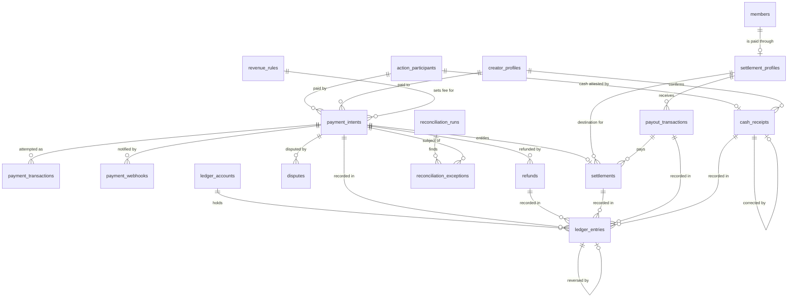

## 7. Referrals

### 7.1 `referral_codes`

**Purpose:** The referral code every registered member receives (architecture 15). Guests have none.

| Attribute | Type | Req | Notes |
|---|---|---|---|
| `id` | id | Req | |
| `member_id` | id | Req | FK `members` |
| `code` | string(20) | Req | Opaque, not sequential |
| `status` | enum | Req | `ACTIVE`, `DISABLED` (P) |

**Invariants:** `code` unique. Unique `member_id`.

### 7.2 `referral_attributions`

**Purpose:** The record that one member was referred by another, with the 12-month reward window.

| Attribute | Type | Req | Notes |
|---|---|---|---|
| `id` | id | Req | |
| `referral_code_id` | id | Req | FK `referral_codes` |
| `referrer_member_id` | id | Req | FK `members` |
| `referred_member_id` | id | Req | FK `members` |
| `attributed_at` | timestamp_utc | Req | |
| `window_ends_at` | timestamp_utc | Req | 12 months after attribution; never extended (architecture 15.1) |
| `status` | enum | Req | `ACTIVE`, `FLAGGED`, `VOID` (P) |
| `source` | string(60) | Opt | For example a QR attribution tag |

**Invariants:** Unique `referred_member_id` (a member is referred once). `referrer_member_id` differs from `referred_member_id` (self-referral prevention; check constraint). A reward is earned on the platform fees of payments received by the referred member as a creator. Payments the referred member makes earn nothing (decision 4).

### 7.3 `referral_rewards`

**Purpose:** One reward earned from one platform fee; it carries the reward state.

| Attribute | Type | Req | Notes |
|---|---|---|---|
| `id` | id | Req | |
| `public_id` | public_id | Req | |
| `referral_attribution_id` | id | Req | FK `referral_attributions` |
| `referrer_member_id` | id | Req | FK `members` |
| `payment_intent_id` | id | Req | FK `payment_intents`. The payment whose platform fee earned it. Its recipient is the referred member's creator profile (decision 4) |
| `platform_fee_minor` | money_minor | Req | The fee the share is taken from |
| `rate_bps` | int | Req | Configurable |
| `reward_minor` | money_minor | Req | |
| `currency` | currency | Req | |
| `state` | enum | Req | `PENDING`, `APPROVED`, `PAID`, `REVERSED`, `EXPIRED` (from architecture 15; names proposed, see `state-machines.md` Section 13) |
| `state_version` | int | Req | |
| `approved_at` | timestamp_utc | Opt | |
| `expires_at` | timestamp_utc | Opt | 12 months after `approved_at`. The reward expires on this date only if the member has had no verified settlement details in that time (decision 5) |
| `paid_at` | timestamp_utc | Opt | |
| `payout_transaction_id` | id | Opt | FK `payout_transactions` |
| `revenue_rule_id` | id | Opt | FK `revenue_rules`. The referral-allocation rule applied |

**Invariants:**
- Unique (`referral_attribution_id`, `payment_intent_id`): one reward per fee.
- `reward_minor` greater than zero. No row is created when the platform fee is zero (for example during the launch fee programme) or for cash (architecture 15.1).
- The payment was confirmed inside the attribution window, and its recipient creator profile belongs to the referred member (decision 4).
- A reward owed to a member with verified settlement details does not expire (decision 5).
- `expires_at` is set once, on approval, and never moved.
- A reward is never a spendable balance and cannot pay for an Action (architecture 15.4).

### 7.4 `referral_reversals`

**Purpose:** The compensating record when a reward is taken back after a refund, chargeback or fraud finding.

| Attribute | Type | Req | Notes |
|---|---|---|---|
| `id` | id | Req | |
| `referral_reward_id` | id | Req | FK `referral_rewards` |
| `reason` | enum | Req | `PAYMENT_REFUNDED`, `CHARGEBACK`, `FRAUD` (P) |
| `amount_minor` | money_minor | Req | |
| `currency` | currency | Req | |
| `refund_id` | id | Opt | FK `refunds` |
| `dispute_id` | id | Opt | FK `disputes` |
| `ledger_entry_id` | id | Opt | FK `ledger_entries`. The `REFERRAL_REVERSAL` entry |
| `reversed_at` | timestamp_utc | Req | |

**Invariants:** Unique `referral_reward_id` (a reward is reversed once). Append-only. Expiry is not a reversal; it is a `REFERRAL_EXPIRY` ledger entry and the `EXPIRED` state on the reward.

### 7.5 Diagram

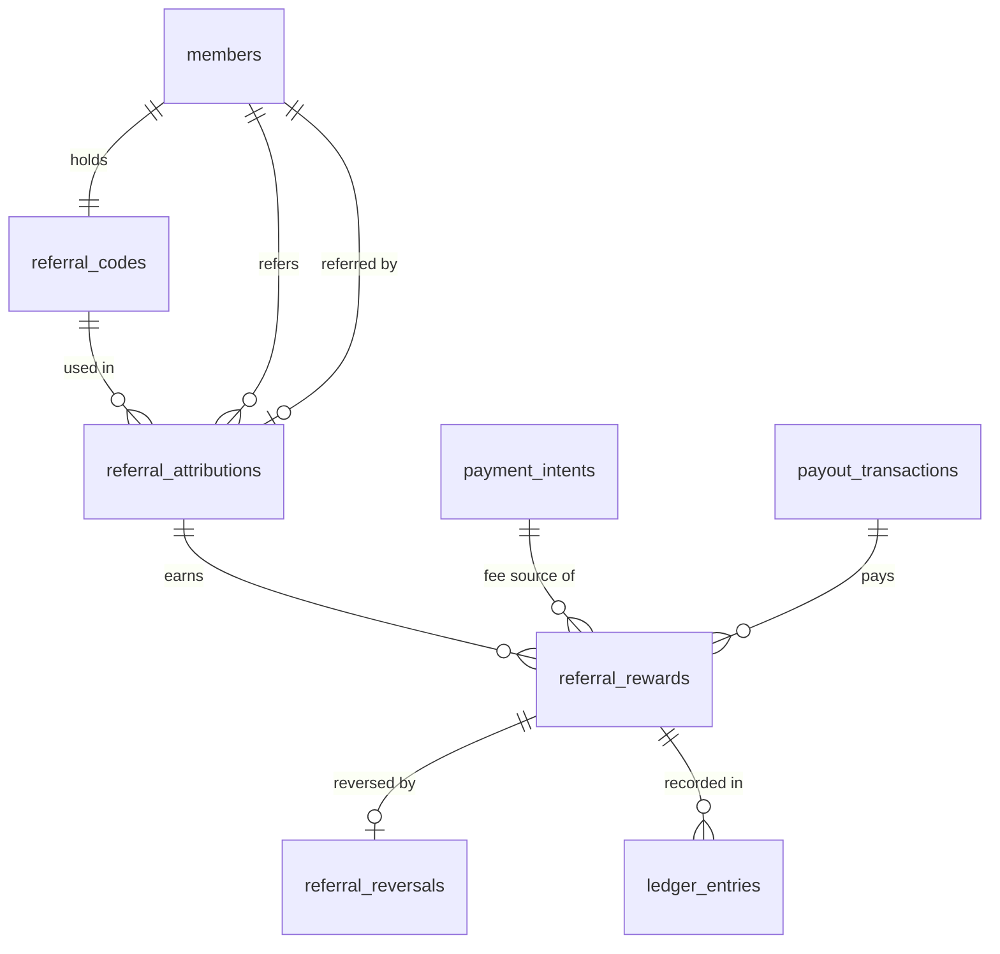

## 8. Country and Localization

### 8.1 `countries`

**Purpose:** The countries the platform knows, and whether each is activated. `ZA` is the MVP1 base (architecture 16).

| Attribute | Type | Req | Notes |
|---|---|---|---|
| `code` | country | Req | The key |
| `name_key` | string(120) | Req | |
| `default_currency` | currency | Req | |
| `default_language` | language | Req | FK `languages` |
| `default_timezone` | string(64) | Req | IANA name. Display only; storage is UTC |
| `status` | enum | Req | `INACTIVE`, `ACTIVE`, `DISABLED` (P) |

**Invariants:** `code` unique. Disabling a country removes no record and no obligation (architecture 16).

### 8.2 `country_configurations`

**Purpose:** Versioned configuration values, global or per country, resolved by domain and field (architecture 16.2).

| Attribute | Type | Req | Notes |
|---|---|---|---|
| `id` | id | Req | |
| `country_code` | country | Opt | Empty means global default |
| `config_domain` | string(60) | Req | For example `payment`, `settlement`, `referral`, `feature` |
| `config_key` | string(120) | Req | For example `settlement.cool_off_seconds` |
| `value` | json | Req | Validated against the field's data type |
| `mandatory_policy` | bool | Req | Missing or invalid mandatory policy fails safe |
| `creator_overridable` | bool | Req | |
| `version` | int | Req | |
| `status` | enum | Req | `DRAFT`, `ACTIVE`, `RETIRED` (P) |
| `effective_from` | timestamp_utc | Req | |
| `effective_until` | timestamp_utc | Opt | |
| `changed_by_member_id` | id | Req | FK `members` (an admin) |

**Invariants:** Unique (`country_code`, `config_key`, `version`). At most one active version of a key per country at a time. Feature flags are held here as keys in the `feature` domain (P); Section 41 lists no feature-flag table.

### 8.3 `country_config_overrides`

**Purpose:** A creator-level override of a field that is explicitly marked overridable (architecture 16).

| Attribute | Type | Req | Notes |
|---|---|---|---|
| `id` | id | Req | |
| `creator_profile_id` | id | Req | FK `creator_profiles` |
| `config_key` | string(120) | Req | |
| `value` | json | Req | |
| `set_by_member_id` | id | Req | FK `members`. Provenance |
| `effective_from` | timestamp_utc | Req | |
| `effective_until` | timestamp_utc | Opt | |

**Invariants:** Unique (`creator_profile_id`, `config_key`, `effective_from`). An override of a non-overridable or mandatory field is rejected. Whether any override is needed in MVP1 is OQ-29.

### 8.4 `languages`

**Purpose:** The languages the platform offers.

| Attribute | Type | Req | Notes |
|---|---|---|---|
| `code` | language | Req | The key |
| `name` | string(80) | Req | |
| `status` | enum | Req | `ACTIVE`, `INACTIVE` (P) |

**Invariants:** `code` unique.

### 8.5 `translations`

Not created in MVP1 (P). Section 41 lists it only "where persisted". See OQ-27.

### 8.6 Diagram

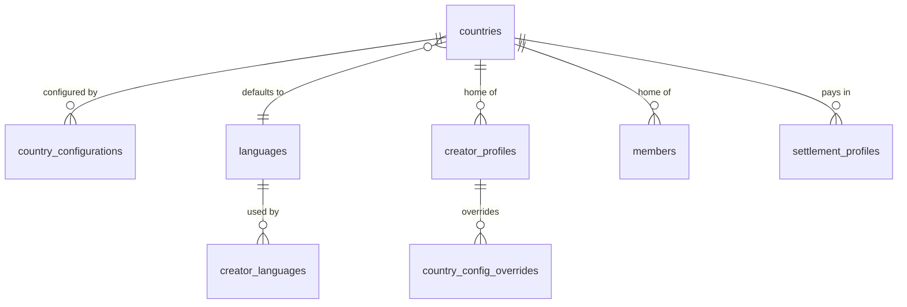

## 9. Notifications and Communication

Notifications are side effects of domain events. They are never the source of truth for a transaction (architecture 31).

### 9.1 `communication_channels`

**Purpose:** The delivery channels the platform supports and whether each is enabled.

| Attribute | Type | Req | Notes |
|---|---|---|---|
| `id` | id | Req | |
| `code` | enum | Req | `IN_APP`, `EMAIL`, `PUSH` in MVP1. `SMS` and `WHATSAPP` are later (architecture 31, 12.8.1) |
| `enabled` | bool | Req | |

**Invariants:** `code` unique.

### 9.2 `notification_preferences`

**Purpose:** A member's choice of which notifications to receive on which channel.

| Attribute | Type | Req | Notes |
|---|---|---|---|
| `member_id` | id | Req | FK `members` |
| `notification_type` | string(80) | Req | |
| `communication_channel_id` | id | Req | FK `communication_channels` |
| `enabled` | bool | Req | |

**Invariants:** Unique (`member_id`, `notification_type`, `communication_channel_id`). Transactional messages such as receipts are not switchable (P).

### 9.3 `notification_templates`

**Purpose:** Versioned, localised message templates.

| Attribute | Type | Req | Notes |
|---|---|---|---|
| `id` | id | Req | |
| `notification_type` | string(80) | Req | |
| `communication_channel_id` | id | Req | FK `communication_channels` |
| `language_code` | language | Req | FK `languages` |
| `version` | int | Req | |
| `subject` | string(200) | Opt | |
| `body` | text | Req | |
| `status` | enum | Req | `DRAFT`, `ACTIVE`, `RETIRED` (P) |

**Invariants:** Unique (`notification_type`, `communication_channel_id`, `language_code`, `version`).

### 9.4 `notifications`

**Purpose:** One message addressed to one member or guest, created from a domain event.

| Attribute | Type | Req | Notes |
|---|---|---|---|
| `id` | id | Req | |
| `public_id` | public_id | Req | |
| `member_id` | id | Cond | FK `members` |
| `guest_session_id` | id | Cond | FK `guest_sessions`. For a guest receipt |
| `notification_type` | string(80) | Req | |
| `source_event_id` | string(64) | Req | The outbox event that caused it |
| `payload` | json | Req | Minimal, privacy-reviewed |
| `read_at` | timestamp_utc | Opt | In-app |

**Invariants:** Exactly one of `member_id` or `guest_session_id`. Unique (`source_event_id`, `notification_type`, recipient) so a replayed event does not notify twice.

### 9.5 `notification_deliveries`

**Purpose:** One attempt to deliver a notification on one channel, with its status.

| Attribute | Type | Req | Notes |
|---|---|---|---|
| `id` | id | Req | |
| `notification_id` | id | Req | FK `notifications` |
| `communication_channel_id` | id | Req | FK `communication_channels` |
| `notification_template_id` | id | Opt | FK `notification_templates` |
| `status` | enum | Req | `QUEUED`, `SENT`, `DELIVERED`, `FAILED` (P) |
| `attempt_count` | int | Req | |
| `provider_message_id` | string(120) | Opt | |
| `last_attempt_at` | timestamp_utc | Opt | |
| `failure_code` | string(60) | Opt | |

**Invariants:** Unique (`notification_id`, `communication_channel_id`).

### 9.6 Diagram

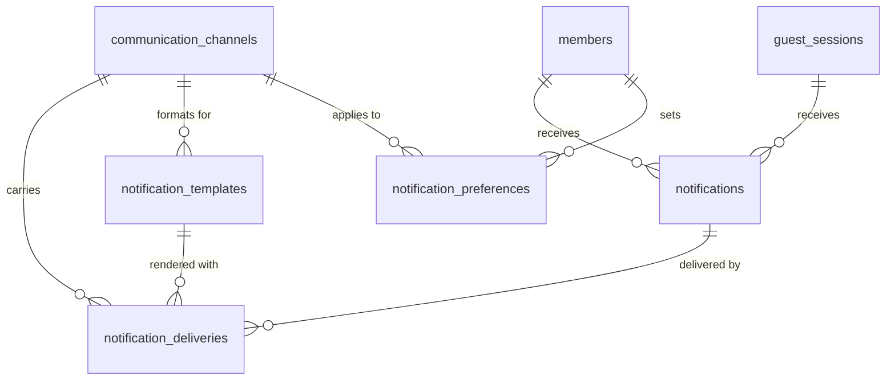

## 10. Trust, Safety and Support

### 10.1 `reports`

**Purpose:** A report by a member or guest about a creator, a Creator Action or a message (architecture 28).

| Attribute | Type | Req | Notes |
|---|---|---|---|
| `id` | id | Req | |
| `public_id` | public_id | Req | |
| `reporter_member_id` | id | Cond | FK `members` |
| `reporter_guest_session_id` | id | Cond | FK `guest_sessions` |
| `subject_type` | enum | Req | `CREATOR_PROFILE`, `CREATOR_ACTION`, `ACTION_MESSAGE` |
| `subject_creator_profile_id` | id | Cond | FK `creator_profiles` |
| `subject_creator_action_id` | id | Cond | FK `creator_actions` |
| `subject_action_message_id` | id | Cond | FK `action_messages` |
| `reason_code` | string(60) | Req | |
| `details` | text | Opt | |
| `state` | enum | Req | `REPORTED`, `UNDER_REVIEW`, `ACTION_REQUIRED`, `RESOLVED`, `DISMISSED`, `ESCALATED` (architecture 28) |
| `moderation_case_id` | id | Opt | FK `moderation_cases` |

**Invariants:** Exactly one reporter. Exactly one subject, matching `subject_type`.

### 10.2 `moderation_cases`

**Purpose:** A unit of moderation work that groups reports and decisions about one subject.

| Attribute | Type | Req | Notes |
|---|---|---|---|
| `id` | id | Req | |
| `public_id` | public_id | Req | |
| `subject_type` | enum | Req | As in `reports`, plus `MEMBER` |
| `subject_id` | id | Req | |
| `status` | enum | Req | `OPEN`, `IN_REVIEW`, `CLOSED` (P) |
| `assigned_to_member_id` | id | Opt | FK `members` (an admin) |
| `notes` | text | Opt | Internal only; never public |
| `closed_at` | timestamp_utc | Opt | |

**Invariants:** At most one open case per subject.

### 10.3 `moderation_actions`

**Purpose:** One decision taken in a case: suspend, restore, disable an Action, restrict a capability, reject a message.

| Attribute | Type | Req | Notes |
|---|---|---|---|
| `id` | id | Req | |
| `moderation_case_id` | id | Req | FK `moderation_cases` |
| `action_type` | enum | Req | `SUSPEND`, `RESTORE`, `DISABLE_ACTION`, `RESTRICT_CAPABILITY`, `REJECT_MESSAGE`, `NOTE` (from architecture 28; names proposed) |
| `actor_member_id` | id | Req | FK `members` (an admin) |
| `reason` | text | Req | |
| `taken_at` | timestamp_utc | Req | |

**Invariants:** Append-only. A restore is a new row, not the deletion of a suspension.

### 10.4 `member_blocks`

**Purpose:** One member blocking another.

| Attribute | Type | Req | Notes |
|---|---|---|---|
| `blocker_member_id` | id | Req | FK `members` |
| `blocked_member_id` | id | Req | FK `members` |
| `blocked_at` | timestamp_utc | Req | |

**Invariants:** Unique (`blocker_member_id`, `blocked_member_id`). The two differ. Whether a creator can block a guest is OQ-30.

### 10.5 `risk_decisions`

**Purpose:** The auditable record of each risk decision on a transaction: allowed, challenged, held or rejected (architecture 28.1).

| Attribute | Type | Req | Notes |
|---|---|---|---|
| `id` | id | Req | |
| `public_id` | public_id | Req | |
| `subject_type` | enum | Req | `PAYMENT_INTENT`, `ACTION_PARTICIPANT`, `SETTLEMENT`, `REFERRAL_REWARD`, `CASH_RECEIPT` (P) |
| `subject_id` | id | Req | |
| `decision` | enum | Req | `ALLOW`, `CHALLENGE`, `HOLD`, `REJECT` (from architecture 28.1) |
| `rule_code` | string(80) | Opt | Which control fired. Thresholds themselves are private |
| `decided_by` | enum | Req | `SYSTEM`, `ADMIN` (P) |
| `actor_member_id` | id | Opt | FK `members` |
| `decided_at` | timestamp_utc | Req | |

**Invariants:** Append-only.

### 10.6 `transaction_limits`

**Purpose:** The limits on how much money may move, by scope and period (architecture 28.1). These are separate from the limits a creator sets on an Action.

| Attribute | Type | Req | Notes |
|---|---|---|---|
| `id` | id | Req | |
| `scope` | enum | Req | `PER_TRANSACTION`, `PER_CONSUMER`, `PER_RECIPIENT`, `PER_ACTION` (from architecture 28.1) |
| `applies_to` | enum | Req | `GUEST`, `NEW_MEMBER`, `MEMBER`, `CREATOR` (P) |
| `country_code` | country | Opt | FK `countries` |
| `period_seconds` | int | Opt | Empty for a single-transaction limit |
| `max_amount_minor` | money_minor | Opt | |
| `max_count` | int | Opt | Velocity |
| `currency` | currency | Cond | |
| `status` | enum | Req | `ACTIVE`, `RETIRED` (P) |
| `effective_from` | timestamp_utc | Req | |
| `effective_until` | timestamp_utc | Opt | |

**Invariants:** At least one of `max_amount_minor` or `max_count`. A creator setting never raises a platform limit.

### 10.7 `support_tickets`

**Purpose:** A lightweight support request (architecture 29).

| Attribute | Type | Req | Notes |
|---|---|---|---|
| `id` | id | Req | |
| `public_id` | public_id | Req | |
| `member_id` | id | Cond | FK `members` |
| `guest_session_id` | id | Cond | FK `guest_sessions` |
| `category` | string(60) | Req | |
| `subject` | string(200) | Req | |
| `description` | text | Req | |
| `related_creator_action_id` | id | Opt | FK `creator_actions` |
| `related_payment_intent_id` | id | Opt | FK `payment_intents` |
| `related_creator_profile_id` | id | Opt | FK `creator_profiles` |
| `status` | enum | Req | `OPEN`, `IN_PROGRESS`, `WAITING_FOR_MEMBER`, `WAITING_FOR_CREATOR`, `RESOLVED`, `CLOSED` (architecture 29) |

**Invariants:** Exactly one of `member_id` or `guest_session_id`.

### 10.8 `support_messages`

**Purpose:** One message in a support ticket's conversation.

| Attribute | Type | Req | Notes |
|---|---|---|---|
| `id` | id | Req | |
| `support_ticket_id` | id | Req | FK `support_tickets` |
| `author_type` | enum | Req | `MEMBER`, `GUEST`, `CREATOR`, `SUPPORT` (P) |
| `author_member_id` | id | Opt | FK `members` |
| `body` | text | Req | |
| `attachment_refs` | json | Opt | Storage references |
| `sent_at` | timestamp_utc | Req | |

**Invariants:** Append-only.

### 10.9 `audit_logs`

**Purpose:** The record of important administrative and security-relevant changes: who, what, when, why.

| Attribute | Type | Req | Notes |
|---|---|---|---|
| `id` | id | Req | |
| `actor_type` | enum | Req | `MEMBER`, `ADMIN`, `SYSTEM` (P) |
| `actor_member_id` | id | Opt | FK `members` |
| `event_type` | string(80) | Req | |
| `subject_type` | string(60) | Req | |
| `subject_id` | id | Opt | |
| `reason` | string(255) | Opt | |
| `changes` | json | Opt | Before and after, with sensitive values removed |
| `correlation_id` | string(64) | Req | |
| `occurred_at` | timestamp_utc | Req | |

**Invariants:** Append-only. The runtime identity cannot update or delete rows.

### 10.10 Diagram

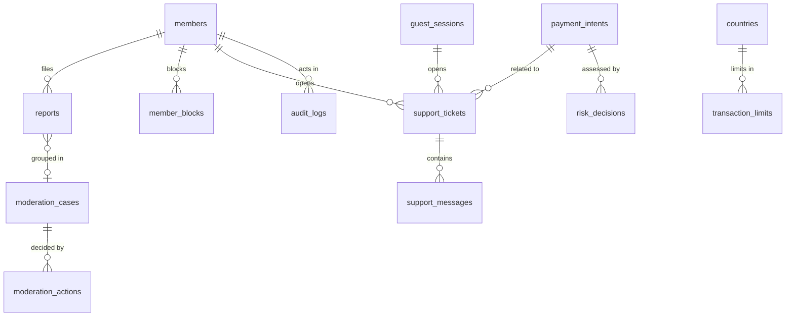

## 11. Marketing and Sponsorship

Only the Starter Pack entities are created in MVP1 (architecture 52.1). Advertising and sponsorship entities are later phase and are **not created in MVP1**: `advertisements`, `advertising_campaigns`, `sponsors/advertisers`, `sponsorships`, `campaign_events`.

### 11.1 `starter_pack_templates`

**Purpose:** A template that says which assets to generate for a creator category, country and language (architecture 26.1).

| Attribute | Type | Req | Notes |
|---|---|---|---|
| `id` | id | Req | |
| `public_id` | public_id | Req | |
| `creator_category_id` | id | Opt | FK `creator_categories`. Empty means any category |
| `country_code` | country | Opt | FK `countries` |
| `language_code` | language | Req | FK `languages` |
| `version` | int | Req | |
| `definition` | json | Req | The asset list and copy |
| `status` | enum | Req | `DRAFT`, `ACTIVE`, `RETIRED` (P) |

**Invariants:** Unique (`creator_category_id`, `country_code`, `language_code`, `version`).

### 11.2 `generated_starter_packs`

**Purpose:** One generated pack for one creator; regenerating makes a new one (architecture 26.6).

| Attribute | Type | Req | Notes |
|---|---|---|---|
| `id` | id | Req | |
| `public_id` | public_id | Req | |
| `creator_profile_id` | id | Req | FK `creator_profiles` |
| `starter_pack_template_id` | id | Req | FK `starter_pack_templates` |
| `status` | enum | Req | `GENERATING`, `READY`, `FAILED`, `SUPERSEDED` (P) |
| `generated_at` | timestamp_utc | Opt | |

**Invariants:** At most one pack per profile that is not `SUPERSEDED` or `FAILED`.

### 11.3 `generated_assets`

**Purpose:** One file or text asset in a generated pack, for example a printable QR sheet.

| Attribute | Type | Req | Notes |
|---|---|---|---|
| `id` | id | Req | |
| `public_id` | public_id | Req | |
| `generated_starter_pack_id` | id | Req | FK `generated_starter_packs` |
| `asset_type` | enum | Req | `QR_IMAGE`, `PRINTABLE_QR_SHEET`, `SOCIAL_GRAPHIC`, `CAPTION`, `OVERLAY`, `GUIDE` (from architecture 26.2; names proposed) |
| `qr_resource_id` | id | Opt | FK `qr_resources` |
| `creator_action_id` | id | Opt | FK `creator_actions` |
| `storage_ref` | string(255) | Opt | |
| `text_content` | text | Opt | |

**Invariants:** At least one of `storage_ref` or `text_content`.

### 11.4 Diagram

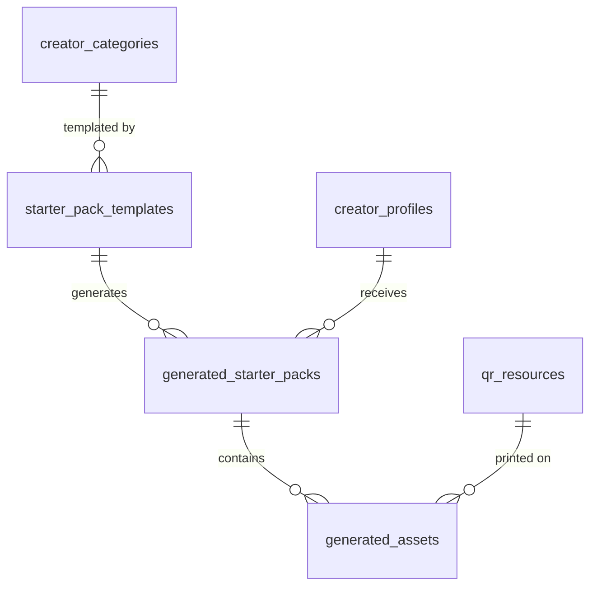

## 12. Event Infrastructure

Events carry asynchronous work and realtime delivery. They never replicate a database (architecture 23). The outbox in MySQL is the durable record; Valkey only carries delivery (architecture 52.2).

### 12.1 `outbox_events`

**Purpose:** A domain event written in the same transaction as the business change, so that it is published reliably afterwards.

| Attribute | Type | Req | Notes |
|---|---|---|---|
| `id` | id | Req | |
| `event_id` | string(64) | Req | The public, unique event ID |
| `event_type` | string(120) | Req | |
| `schema_version` | int | Req | |
| `aggregate_type` | string(60) | Req | |
| `aggregate_public_id` | public_id | Req | Events refer to public IDs only |
| `aggregate_version` | int | Opt | The entity's `state_version` |
| `correlation_id` | string(64) | Req | |
| `causation_id` | string(64) | Opt | |
| `producer` | string(60) | Req | |
| `payload` | json | Req | Minimal and privacy-reviewed |
| `occurred_at` | timestamp_utc | Req | |
| `published_at` | timestamp_utc | Opt | |
| `publish_attempts` | int | Req | |

**Invariants:** `event_id` unique. Rows are inserted only inside the business transaction. The payload is never edited after insert.

### 12.2 `processed_events`

**Purpose:** The record that a named consumer has handled an event, so a duplicate delivery does nothing.

| Attribute | Type | Req | Notes |
|---|---|---|---|
| `consumer_name` | string(80) | Req | |
| `event_id` | string(64) | Req | |
| `processed_at` | timestamp_utc | Req | |

**Invariants:** Unique (`consumer_name`, `event_id`). The row is written in the same transaction as the consumer's effect.

### 12.3 `idempotency_keys`

**Purpose:** The stored result of a client request with an idempotency key, so a retry gets the same answer.

| Attribute | Type | Req | Notes |
|---|---|---|---|
| `id` | id | Req | |
| `scope` | string(120) | Req | The principal plus the operation |
| `idempotency_key` | string(120) | Req | |
| `request_hash` | string(64) | Req | Detects the same key with a different body |
| `status` | enum | Req | `IN_PROGRESS`, `COMPLETED` (P) |
| `response_status` | int | Opt | |
| `response_body` | json | Opt | |
| `expires_at` | timestamp_utc | Req | |

**Invariants:** Unique (`scope`, `idempotency_key`). The same key with a different `request_hash` is a conflict, not a replay.

### 12.4 Diagram

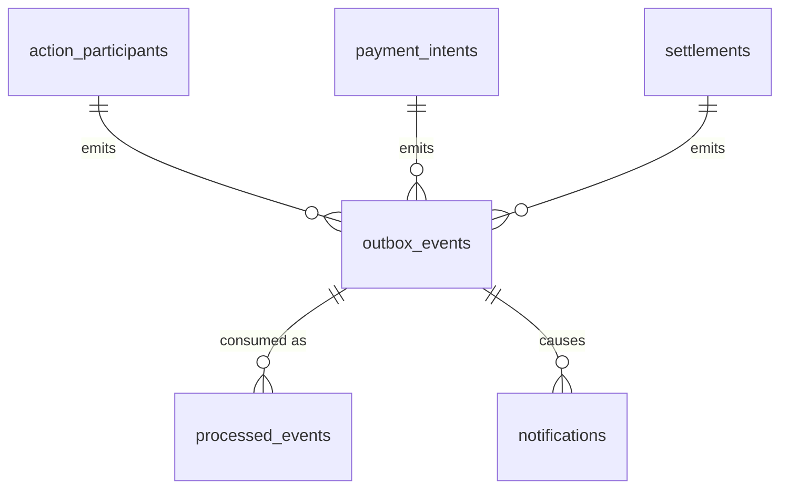

The links from business entities to `outbox_events` are by `aggregate_public_id`, not by foreign key.

## 13. Organisations

**Not created in MVP1** (architecture 41.1, 52.1): `organisations`, `organisation_members`, `profile_representations`.

What MVP1 does so as not to block them: `creator_profiles.management_type` exists with the single value `SELF_MANAGED`; the payee and destination are on `settlement_profiles`, not on the profile; transactional entities refer to a "recipient" profile.

## 14. SEO / Music-DJ Vertical

**Not created in MVP1** (later phase, architecture 12.8.1): `provider_sources`, `provider_imports`, `provider_profiles`, `provider_claims`, `provider_removals`.

The two live-session tables below are proposed as an MVP1 foundation because other MVP1 rules refer to a session: a fulfilment deadline at "the end of the live session" (architecture 8.1), a live-session QR (architecture 9) and the event/session context on a cash receipt (architecture 12.5.3). Whether they are in MVP1 is OQ-08.

### 14.1 `live_sessions` — Foundation (P)

**Purpose:** A period during which a creator is live, in person or online, that Actions, QR codes and cash receipts can be tied to.

| Attribute | Type | Req | Notes |
|---|---|---|---|
| `id` | id | Req | |
| `public_id` | public_id | Req | |
| `creator_profile_id` | id | Req | FK `creator_profiles` |
| `title` | string(120) | Opt | |
| `status` | enum | Req | `SCHEDULED`, `LIVE`, `ENDED`, `CANCELLED` (P) |
| `starts_at` | timestamp_utc | Opt | |
| `ended_at` | timestamp_utc | Opt | The moment `AT_SESSION_END` deadlines fall due |

**Invariants:** At most one `LIVE` session per creator profile (P).

### 14.2 `live_external_links` — Foundation (P)

**Purpose:** A link from a live session to the external stream it accompanies; FAKA does not host the stream (architecture 10).

| Attribute | Type | Req | Notes |
|---|---|---|---|
| `id` | id | Req | |
| `live_session_id` | id | Req | FK `live_sessions` |
| `platform` | string(40) | Req | |
| `url` | string(500) | Req | |

**Invariants:** Unique (`live_session_id`, `url`).

### 14.3 Diagram

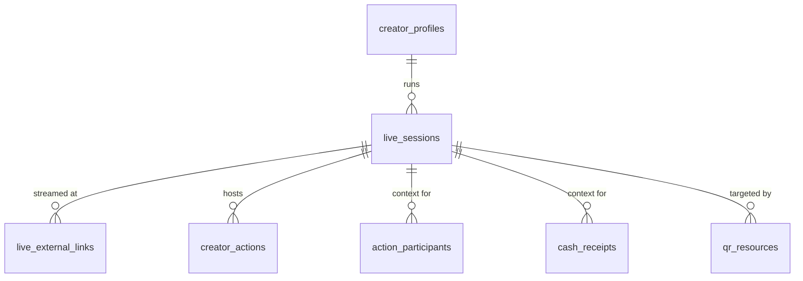

## 15. Open questions

The open questions on this model are kept in the private repository and are not published: they are questions that are not yet settled. `OQ-` numbers elsewhere in this file refer to that list.

## 16. As built in `api-symfony` (recorded 2026-10-15)

The Symfony reference implementation owns the schema (architecture Section 42). Its Doctrine migrations up to `Version20261015120000` create the tables below. These are facts about the migrations in the repository, not about any deployed database. Every migration has run on SQLite in the test suite; the migrations up to the trust-and-safety pair were written for MySQL 8.4 and a MySQL 8.4 CI job exists, but this file does not claim that every migration has passed on MySQL 8.4.

Conventions as built, for every table:

- Internal key `id`: `BIGINT UNSIGNED AUTO_INCREMENT`, never exposed (OQ-01 proposal).
- `public_id`: 26 random characters from a 32-character alphabet, no type prefix. Columns that hold public identifiers compare with `utf8mb4_bin`.
- Timestamps are `DATETIME` in UTC; the session time zone is UTC.
- Enumerations are strings. JSON values use MySQL's `JSON` type, which does **not** keep object key order; anything that must be returned byte for byte is stored as text (Section 16.11).

Only the tables that are new, or differ from the sections above, are listed. The identity, creator, follow, QR, Creator Action, option, playlist, participant Action, message and state-history tables follow Sections 3 to 5 closely; their differences are noted in 16.11.

### 16.1 `outbox_events` (as built; Section 12.1)

| Attribute | Type | Req | Notes |
|---|---|---|---|
| `id` | id | Req | |
| `event_id` | string(64) | Req | Unique |
| `event_type` | string(120) | Req | |
| `schema_version` | int | Req | |
| `aggregate_type` | string(60) | Req | |
| `aggregate_public_id` | string(64) | Req | A public ID, a QR short code or a country code |
| `aggregate_version` | int | Req | **Deviation:** required, and assigned by the outbox as the next number in the aggregate's own event sequence, not copied from `state_version`. Unique (`aggregate_type`, `aggregate_public_id`, `aggregate_version`) |
| `correlation_id` | string(128) | Req | Indexed |
| `causation_id` | string(64) | Opt | |
| `producer` | string(60) | Req | `api-symfony` |
| `payload` | json | Req | Minimal and privacy-reviewed |
| `occurred_at` | timestamp_utc | Req | |
| `status` | enum | Req | `PENDING`, `PUBLISHED`, `DEAD`. **Added** |
| `publish_attempts` | int | Req | |
| `next_attempt_at` | timestamp_utc | Req | Backoff. **Added** |
| `claim_token`, `claimed_until` | string(32), timestamp_utc | Opt | The relay's lease. **Added** |
| `published_at` | timestamp_utc | Opt | |
| `last_error` | string(255) | Opt | No payload or secret. **Added** |
| `dead_at` | timestamp_utc | Opt | **Added** |

### 16.2 `processed_events` (as built; Section 12.2)

As Section 12.2, with a surrogate `id`. Unique (`consumer_name`, `event_id`); indexed on `processed_at` for purging.

### 16.3 `audit_logs` (as built; Section 10.9)

| Attribute | Type | Req | Notes |
|---|---|---|---|
| `id` | id | Req | |
| `actor_type` | enum | Req | `MEMBER`, `ADMIN`, `GUEST`, `SYSTEM`, `COMMAND` (a console operator) |
| `actor_public_id` | string(64) | Opt | **Deviation:** a public ID, not a foreign key to `members` (OQ-42) |
| `actor_name` | string(80) | Opt | For a console operator. **Added** |
| `action` | string(80) | Req | **Renamed** from `event_type`, so it is not confused with domain events. For example `CREATOR_PROFILE_SUSPENDED`, `ADMIN_ROLE_GRANTED`, `AUDIT_LOG_VIEWED` |
| `target_type` | string(60) | Req | **Renamed** from `subject_type` |
| `target_public_id` | string(64) | Opt | **Deviation:** a public ID or code, not an internal key |
| `changes` | json | Opt | Before and after, sensitive values removed |
| `reason` | string(255) | Opt | |
| `correlation_id` | string(128) | Req | |
| `occurred_at` | timestamp_utc | Req | |

Append-only. The admin audit-log viewer records its own use (`AUDIT_LOG_VIEWED`, with the filters and never the results). Whether the runtime database user is denied `UPDATE` and `DELETE` on this table is a deployment matter not yet done.

### 16.4 `countries` and `languages` (as built; Sections 8.1, 8.4)

- `countries`: surrogate `id`, unique `code`, `name` (**deviation:** a plain name, not a translation key), `status` (`ACTIVE`, `INACTIVE`; `DISABLED` is not built), `default_currency`, `default_timezone`, and `default_language_id` (FK `languages`). Seeded with `ZA` (`ZAR`, `Africa/Johannesburg`, `en-ZA`), the only active country.
- `languages`: surrogate `id`, unique `code` (up to 35 characters), `name`, `status`. Seeded with `en`, `en-ZA`, `zu`, `xh`, `af`.

### 16.5 `country_configurations` (as built; Section 8.2)

As Section 8.2, with these differences:

- `country_code` is **required**: there is no global row (OQ-44). Global and base values are code-defined layers of the resolver, which applies global, base, country and creator-override layers in that order, never lets a lower layer weaken a mandatory policy value, and fails safe when a mandatory value is missing or invalid.
- Provenance is `changed_by` (text, required; for example `MIGRATION` or a console operator) plus `changed_by_member_id` (optional FK `members`), and an optional `reason`. Section 8.2 has only a required member.
- Unique (`country_code`, `config_key`, `version`). Each change adds a version with an effective date; nothing is edited in place. Changes are made by console command or the admin web page, with confirmation, an audit entry and `CountryConfigurationUpdated`.
- Seeded keys for `ZA`, all marked "MVP1 provisional value": `currency.supported` (`["ZAR"]`), `limits.max_action_amount_minor` (`10000000`), `participation.guest_allowed` (`true`), `settlement.max_fulfilment_period_seconds` (`604800`).

### 16.6 `country_config_overrides` (as built; Section 8.3)

As Section 8.3. No overridable field is used at launch (OQ-29 proposal).

### 16.7 Effect of an inactive country

A creator profile can be created or moved only to an active country. A Creator Action can be created only while its creator's country is active; existing ones can still be changed. Participation in a Creator Action whose creator's country is not active is declined without a reason.

### 16.8 `admin_role_grants` (new; not in Section 41)

**Purpose:** a staff permission held by a member, for the web admin.

| Attribute | Type | Req | Notes |
|---|---|---|---|
| `id` | id | Req | |
| `member_id` | id | Req | FK `members` |
| `role` | enum | Req | `ADMIN_SUPPORT`, `ADMIN_MODERATOR`, `ADMIN_OPERATIONS` (P) |
| `granted_at` | timestamp_utc | Req | |
| `granted_by` | string(80) | Req | The console operator |
| `grant_reason` | string(255) | Req | |
| `revoked_at` | timestamp_utc | Opt | |
| `revoked_by` | string(80) | Opt | |
| `revoke_reason` | string(255) | Opt | |
| `updated_at` | timestamp_utc | Req | |

**Invariants:** Unique (`member_id`, `role`): a revoked grant is reused when the role is granted again. Roles are granted and revoked by console command only, each with an audit entry and `AdminRoleGranted` or `AdminRoleRevoked`. Roles are read from the database on every admin request, so a revocation takes effect on the next request. Every `/admin` action checks the role on the server and needs a recent re-sign-in; a member without a role gets the same `404` as an unknown route. There is no API for any of this (admin is web-only).

### 16.9 `reports`, `moderation_cases`, `moderation_actions` (as built; Sections 10.1 to 10.3)

- `reports`: as Section 10.1. `reason_code` values are `api-symfony`'s proposal (OQ-43). The optional `details` pass the same automatic screening as a Shout-out message before they are stored. A guest who reports without a guest session is given one, so that every report has exactly one reporter. Reports are filed from the web pages only and are rate limited.
- `moderation_cases`: as Section 10.2, plus `escalated_at`, `updated_at` and `open_subject_key`. **Deviation:** "at most one open case per subject" is enforced by a unique, nullable `open_subject_key` that is set only while the case is open (the technique proposed in OQ-21). `subject_type` covers `CREATOR_PROFILE`, `CREATOR_ACTION` and `ACTION_MESSAGE`; `MEMBER` is not built.
- `moderation_actions`: as Section 10.3, plus `target_ref` (the public ID or QR code acted on). **Deviation:** `action_type` uses the built decision names (OQ-43). Each decision is written with its audit entry and `ModerationActionTaken`; an enforcement also emits the event of its effect.

### 16.10 `guest_sessions` (as built; Section 3.10)

As Section 3.10 except: `contact_email` and `contact_phone_e164` are **not built** (guest receipt contact is out of scope so far); `last_used_at` is **added** for renewal on use (decision 23); `converted_member_id` and `converted_at` were added by a later migration. Conversion is an explicit act by a signed-in member on the web, links the guest's Actions to the member without copying them, is audited and emits `GuestSessionConverted`.

### 16.11 Smaller differences in tables that follow the model

- **`lock_version`** on `creator_actions` and `action_participants` (**added**): an optimistic-lock counter, separate from `state_version`, that changes on every update. A change prepared on a stale copy is refused (`CREATOR_ACTION_STATE_CONFLICT` or `ACTION_STATE_CONFLICT`). Changes also run under row locks taken in a fixed order.
- **`creator_actions`**: holds `config_version` (the current version number) instead of `current_config_id`; `live_session_id` is not built.
- **`action_participants`**: `live_session_id` is not built. The free-text rejection reason is kept in `state_transitions.reason`, not on the Action.
- **`idempotency_keys`**: `response_body` is **text** (`LONGTEXT`), not `json`, so that a replay is byte for byte identical: MySQL's `JSON` type reorders object keys. The key column holds up to 128 characters (`utf8mb4_bin`). `created_at` and `updated_at` are present.
- **`qr_resources`**: adds `revocation_reason`. `EXPIRED` is computed from `expires_at` when a code is resolved; it is not written.
- **`state_transitions`**: as Section 4.14, with `trigger_name` for `trigger` and `correlation_id` up to 128 characters.
- **Not built yet:** every table in Sections 6 (payments and ledger), 7 (referrals), 9 (notifications), `consent_records`, `policy_documents`, `policy_acceptances`, `creator_verifications`, `action_bids`, `action_tips`, `action_queue_entries`, `member_blocks`, `risk_decisions`, `transaction_limits`, support tickets, Starter Pack tables and live sessions.
