# FAKA iAction — MVP1 State Machines

**Status:** Draft for review. Milestone M1 contract deliverable. Revised 2026-10-15 with API contract `1.0.0-alpha.2`. The Creator Action, participant Action (free path) and QR machines are implemented in `api-symfony`; Section 17 records where that implementation differs from this file. Nothing here is claimed as tested in production.
**Source of truth:** Master Architecture v2.10 (approved 2026-10-13). Where this file and the architecture disagree, the architecture wins.
**Also read:** TIS v0.3 (review draft) Sections 8 and 9, and `domain-model.md` in this folder.
**Product decisions:** the product decision record (not published). Its decisions are applied here and are stated as fact, with the decision number. Decisions 1 to 16 are in architecture v2.10; decisions 17 to 25 are not yet in an approved architecture and are carried in the v2.11 draft.

## 1. How to read this file

### 1.1 What is fixed and what is proposed

- A state name written in `CAPITALS` and attributed to an architecture section is canonical and is used unchanged.
- **(P)** marks a proposal: a transition, name or rule that the architecture does not define. Every (P) is listed again in Section 16 "Decisions needed" with a `DN-` number. Do not treat a proposal as decided.

### 1.2 The machines are separate

The architecture requires that Action, Payment and Settlement states are held separately and linked by reference (Sections 8, 13.3, 62.7). This file adds the machines that sit beside them.

| Machine | Entity that holds the state | Section here |
|---|---|---|
| Creator Action configuration | `creator_actions.state` | 2 |
| Participant Action (Request, Vote, Bid, Shout-out, Tip) | `action_participants.state` | 3 to 8 |
| Payment | `payment_intents.state` | 9 |
| Cash receipt | `cash_receipts.state` | 10 |
| Settlement | `settlements.state` | 11 |
| Payout eligibility | `settlement_profiles.payout_eligibility_state` | 12 |
| Referral reward | `referral_rewards.state` | 13 |
| QR resource | `qr_resources.state` | 14 |

Refund and dispute are **payment** states. An Action is never "refunded" or "disputed" (architecture 62.6).

### 1.3 Who can trigger a transition

| Actor | Meaning |
|---|---|
| Participant | The member or guest who made the Action. A guest is a limited principal (architecture 43.1). |
| Creator | The authenticated member who owns the creator profile. In MVP1 nobody acts on the creator's behalf. |
| System | A rule applied by the backend: inside a transaction, or by a scheduled worker. |
| Provider | The PSP, through an authenticated webhook or a server-to-server query. A browser redirect is never proof (TIS 9.2). |
| Admin | Platform staff acting through the Admin API (architecture 27). Includes moderators. |

### 1.4 Rules that apply to every transition

1. Every transition is validated on the server and recorded with actor, time, reason and correlation ID (TIS 7.2, 8.2).
2. A repeated or invalid transition returns a deterministic result. It never applies twice (TIS 8.2).
3. A state change, its ledger posting and its outbox event are written in one database transaction (TIS 9.3).
4. Consumers tolerate duplicate and out-of-order events and re-check the current state before acting (TIS 8.5).
5. A provider timeout means "unknown outcome". The system queries the provider; it does not retry a payment side effect blindly (TIS 8.4).

Event names in the tables are indicative. The event contract in `../events` is authoritative for names and payloads.

## 2. Creator Action configuration lifecycle

Source: architecture Section 8. This is the lifecycle of the definition a creator publishes, not of a participant's Action.

### 2.1 States

| State | Meaning |
|---|---|
| `DRAFT` | Being set up. Not visible to the public. |
| `PUBLISHED` | Visible on the creator's page. Not yet open for participation (decision 17). |
| `ACTIVE` | Open for participation. |
| `PAUSED` | Temporarily closed to new participation. |
| `EXPIRED` | The end time has passed. |
| `DISABLED` | Turned off by the creator or by the platform. |

The architecture gives the order `DRAFT → PUBLISHED → ACTIVE → PAUSED / EXPIRED / DISABLED` and nothing more. The difference between `PUBLISHED` and `ACTIVE` is decided (decision 17: published is visible but not yet open; active is open for participation). Every return path is still a proposal (DN-02).

### 2.2 Transitions

| From | To | Trigger | Who | Preconditions | Side effects / events |
|---|---|---|---|---|---|
| (new) | `DRAFT` | Create | Creator | Member has the creator capability; Action type is available in the country | `creator_action.created` |
| `DRAFT` | `PUBLISHED` | Publish | Creator | A valid config version exists; the type's required fields are set; a paid config has a fulfilment deadline rule that falls inside the cool-off (except Tip); cash is enabled only on a self-managed profile where policy allows; platform policy and limits pass | `creator_action.published`; QR and share links become usable |
| `PUBLISHED` | `ACTIVE` | Start time reached, or no start time set | System | Creator profile is published and not suspended | `creator_action.activated` |
| `ACTIVE` | `PAUSED` | Pause | Creator | None | `creator_action.paused`. No new participation. Open participant Actions run on to their own deadlines (decision 6) |
| `PAUSED` | `ACTIVE` | Resume (P, DN-02) | Creator | End time not passed | `creator_action.activated` |
| `PUBLISHED`, `ACTIVE`, `PAUSED` | `EXPIRED` | End time reached | System | `ends_at` is set and has passed | `creator_action.expired`. No new participation. Open participant Actions run on to their own deadlines (decision 6) |
| `EXPIRED` | `ACTIVE` | Creator sets a later end time (P, DN-02) | Creator | New end time is in the future | `creator_action.activated` |
| `DRAFT`, `PUBLISHED`, `ACTIVE`, `PAUSED`, `EXPIRED` | `DISABLED` | Disable | Creator, or Admin (moderation: "disable action", architecture 28) | None | `creator_action.disabled`. Every unfulfilled paid Action on it moves to `CANCELLED` and each of its confirmed PSP payments is refunded in full (decision 6; architecture 7.4.1 for bids). Unfulfilled free Actions are cancelled too (decision 18) |
| `DISABLED` | `ACTIVE` | Re-enable (P, DN-02) | Creator if the creator disabled it; Admin only if the platform disabled it | End time not passed; platform policy passes | `creator_action.activated` |

### 2.3 Timeouts

- Start time: `PUBLISHED → ACTIVE`.
- End time: `→ EXPIRED`.

### 2.4 Terminal states

None is strictly terminal under the proposals above. If DN-02 is decided the other way, `EXPIRED` and `DISABLED` are terminal.

### 2.5 Editing a live Creator Action

A change to price, deadline or rules creates a new config version. It applies to new participants only. Participant Actions already made keep the version they were made under (decision 19). A change to the title, description, start or end time alone does not create a version.

### 2.6 Diagram

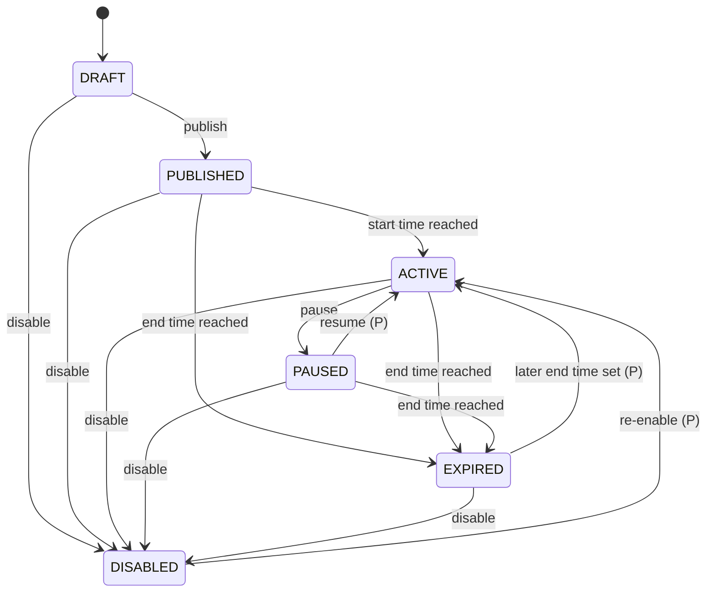

## 3. Participant Action: common vocabulary

Source: architecture Section 62.6.

`CREATED → SUBMITTED/INITIATED → ACCEPTED/PROCESSING → FULFILLED → COMPLETED`

Alternative terminal or error states: `CANCELLED`, `EXPIRED`, `REJECTED`, `FAILED`.

The architecture offers `SUBMITTED/INITIATED` and `ACCEPTED/PROCESSING` as pairs and does not say how they differ. This file uses them as follows (P, DN-05).

| State | Use in this file |
|---|---|
| `CREATED` | The participant has filled in the Action. It does not count yet. |
| `INITIATED` | A payment is required and has been started (an online payment, or a cash report), but is not confirmed. Paid Actions only. |
| `SUBMITTED` | The Action counts. For a paid Action its payment is confirmed; for a free Action it has been sent. |
| `ACCEPTED` | The creator has approved it, or no approval was needed. It is in the creator's queue. |
| `PROCESSING` | Not used in MVP1 (P, DN-05). |
| `FULFILLED` | The creator has marked it done. This is the creator's attestation (architecture 8.1). |
| `COMPLETED` | Closed successfully. Nothing further is expected (P, DN-06). |
| `REJECTED` | The creator declined this one Action, or moderation rejected it (architecture 8.1). |
| `CANCELLED` | Withdrawn by the participant before payment is confirmed (decision 7), or the Creator Action was disabled (decision 6). The split from `REJECTED` is a proposal (DN-09). |
| `EXPIRED` | The fulfilment deadline passed without fulfilment (architecture 8.1). |
| `FAILED` | The payment was never confirmed (P, DN-07). |

### 3.1 Rules shared by all five types

1. **Payment does not move the Action past `SUBMITTED`.** A confirmed payment does not mean the Action is fulfilled (architecture 62.6). Tip is the one exception, by rule (architecture 7.7).
2. **Fulfilment deadline.** Every paid Action other than a Tip has a fulfilment deadline taken from the config. It is shown before payment and it falls inside the cool-off (architecture 8.1). A free Action has a fulfilment deadline under the same rule, with no payment effect (decision 24); a period "after payment" is counted from submission. A Vote has none.
3. **Automatic refund.** When a paid Action becomes `REJECTED`, `EXPIRED` or `CANCELLED` with a confirmed PSP payment, every confirmed payment of that Action is refunded in full, without the participant asking. No platform fee is kept. The Action state stays what it is; the payment becomes `REFUNDED` (architecture 8.1; TIS 9.6).
4. **Cash is outside the refund rule.** FAKA holds no cash, so there is nothing to refund. A cash refund is between the creator and the customer (architecture 8.1, 12.5.3).
5. **Guest participation** is allowed only where the config allows it. It never creates a member account (architecture 5.1).
6. **A dispute does not change the Action state.** A participant can dispute a fulfilled Action during the cool-off; that is handled on the payment (architecture 8.1).
7. **Idempotency.** A repeated submission with the same idempotency key returns the first Action. It never creates a second Action or a second payment.

## 4. Request

"I choose." A participant selects something the creator has made available (architecture 7.2). A Request can be free or paid.

### 4.1 States

`CREATED`, `INITIATED`, `SUBMITTED`, `ACCEPTED`, `FULFILLED`, `COMPLETED`, `REJECTED`, `CANCELLED`, `EXPIRED`, `FAILED`.

### 4.2 Transitions

| From | To | Trigger | Who | Preconditions | Side effects / events |
|---|---|---|---|---|---|
| (new) | `CREATED` | Participant sends the request | Participant | Creator Action is `ACTIVE`; guests allowed if the participant is a guest; the chosen option or playlist item is available; duplicate and quantity limits pass; risk decision is not reject | Action stored with the config version; `action.created` |
| `CREATED` | `SUBMITTED` | Free Action is sent | System, in the same request | Config is free | Fulfilment deadline set (decision 24); `action.submitted`; creator notified |
| `CREATED` | `INITIATED` | Payment started | Participant | Config is paid; transaction limits pass; for cash: cash is enabled and no online payment is open (architecture 12.5.3) | Online: payment `CREATED`. Cash: cash receipt `CASH_REPORTED_PENDING_CREATOR_CONFIRMATION`. `action.initiated` |
| `INITIATED` | `SUBMITTED` | Payment `CONFIRMED`, or cash receipt `CASH_CONFIRMED_BY_CREATOR` | System, on the Provider's verified result; or Creator for cash | Amount and currency match the Action | Fulfilment deadline set; receipt sent; `action.submitted`; creator notified. Financial effects are in Sections 9 and 10 |
| `SUBMITTED` | `ACCEPTED` | Creator approves; or automatic when approval is not required | Creator; or System | Deadline not passed | Queue entry created; participant notified; `action.accepted` |
| `SUBMITTED`, `ACCEPTED` | `REJECTED` | Creator declines | Creator (or Admin, moderation) | Not yet fulfilled | Automatic full refund of any confirmed PSP payment; queue entry removed; participant notified; `action.rejected` |
| `ACCEPTED` | `FULFILLED` | Creator marks it fulfilled | Creator | Deadline not passed | `fulfilled_at` recorded; queue entry done; `action.fulfilled`. The payment can now become settlement-eligible once the other conditions hold (Section 11) |
| `SUBMITTED`, `ACCEPTED` | `EXPIRED` | Fulfilment deadline passes | System (scheduled worker) | Not fulfilled | Automatic full refund of any confirmed PSP payment; a free Action expires with no payment effect (decision 24); participant and creator notified; `action.expired`. Idempotent: a retry does not refund twice |
| `SUBMITTED`, `ACCEPTED` | `CANCELLED` | The Creator Action is disabled (Section 2) | System, caused by Creator or Admin | Not fulfilled | Automatic full refund of any confirmed PSP payment; `action.cancelled` |
| `CREATED`, `INITIATED` | `CANCELLED` | Participant withdraws before payment is confirmed (decision 7) | Participant | No confirmed payment | Any open payment is expired; any pending cash receipt is voided; `action.cancelled` |
| `INITIATED` | `FAILED` | Payment not confirmed in time (P, DN-07) | System | The last payment is `FAILED` or `EXPIRED` and the checkout window has closed; or the cash confirmation window has closed | `action.failed`; participant notified where contact exists |
| `FULFILLED` | `COMPLETED` | Close-out (P, DN-06) | System | Free or cash Action: immediately. PSP-paid Action: the cool-off has ended and no dispute is open | `action.completed` |

### 4.3 Timeouts

| Timeout | Starts | Result |
|---|---|---|
| Checkout window | Payment started | Payment `EXPIRED`; Action `FAILED` if no retry succeeds (P, DN-07, DN-10) |
| Cash confirmation window | Cash reported | Action `FAILED`; receipt voided (P, DN-27) |
| Fulfilment deadline | Set when the Action becomes `SUBMITTED` | Action `EXPIRED`; automatic refund (architecture 8.1) |
| Cool-off | Payment confirmed | `FULFILLED → COMPLETED` (P, DN-06) |

There is no separate approval timeout. An Action that the creator neither approves nor declines expires at the fulfilment deadline (P, DN-12).

### 4.4 Terminal states

`COMPLETED`, `REJECTED`, `CANCELLED`, `EXPIRED`, `FAILED`.

### 4.5 Diagram

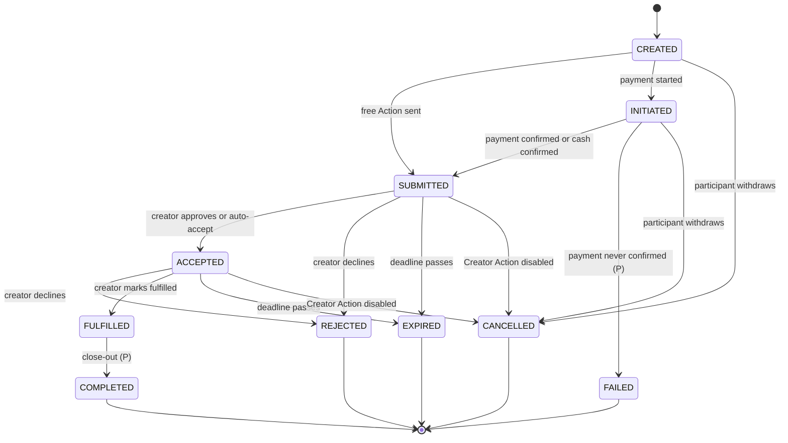

## 5. Vote

"We choose." The audience selects among creator-defined options (architecture 7.3). **Votes are free in MVP1.** Paid votes are later phase (architecture 12.8.1), so a Vote has no payment, no cash receipt, no refund and no settlement.

### 5.1 States

`CREATED`, `SUBMITTED`, `COMPLETED`, `REJECTED`, `CANCELLED`.

`INITIATED`, `ACCEPTED`, `FULFILLED`, `EXPIRED` and `FAILED` are not used: there is no payment and no fulfilment by the creator for a single vote.

### 5.2 Transitions

| From | To | Trigger | Who | Preconditions | Side effects / events |
|---|---|---|---|---|---|
| (new) | `CREATED` | Participant sends a vote | Participant | Creator Action is `ACTIVE` and inside its voting window; guests allowed if the participant is a guest; the option belongs to this Action and is available | Action stored |
| `CREATED` | `SUBMITTED` | Vote is accepted and counted | System, in the same request | The participant has not used up the votes the voting rules allow; rate limits and risk controls pass | Vote counted; `action.submitted`; live tally updated as a projection |
| `CREATED` | `REJECTED` | Vote is not accepted | System | Vote limit reached, or the voting window has closed, or a risk control rejects it | `action.rejected`; the participant is told why. Not counted |
| `SUBMITTED` | `COMPLETED` | Voting closes (decision 20) | System | Creator Action becomes `EXPIRED`, or the creator closes the vote | Result is final; `action.completed`; the tally becomes visible to participants (decision 21) |
| `SUBMITTED` | `CANCELLED` | The Creator Action is disabled before voting closes | System, caused by Creator or Admin | None | Vote no longer counts; `action.cancelled` |
| `SUBMITTED` | `REJECTED` | Vote removed for abuse | Admin | A moderation or risk decision is recorded | Vote no longer counts; `action.rejected`; audit log entry |

A vote cannot be changed once submitted (decision 9). The participant cannot switch it to another option or withdraw it.

### 5.3 Timeouts

- Voting window: the Creator Action's start and end times. At the end, all `SUBMITTED` votes become `COMPLETED` (decision 20).
- Tally: shown to participants once voting closes, not before (decision 21). The owning creator sees it at any time. A disabled Vote has no result, because its votes were cancelled (decision 18).

### 5.4 Terminal states

`COMPLETED`, `REJECTED`, `CANCELLED`.

### 5.5 Diagram

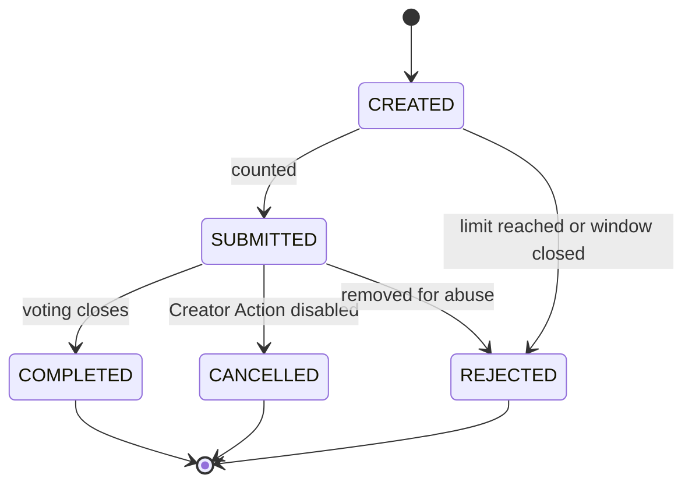

## 6. Bid

"I want priority and I am willing to pay for it." Source: architecture 7.4 and 7.4.1; TIS 8.2.1.

A bid buys a place in the priority order. It is not an all-or-nothing win. Every bidder pays when bidding. There are no card holds.

### 6.1 States

`CREATED`, `INITIATED`, `SUBMITTED`, `ACCEPTED`, `FULFILLED`, `COMPLETED`, `REJECTED`, `CANCELLED`, `EXPIRED`, `FAILED`.

A bid is **ranked** while it is `SUBMITTED` or `ACCEPTED` (P, DN-16). Rank is an attribute of the bid (`action_bids.current_rank`), not a state. Being outbid changes the rank and leaves the state alone.

### 6.2 Ranking

1. A bid does not count until its payment is `CONFIRMED` (architecture 7.4.1).
2. Bids on the same Creator Action are ordered by the creator's ranking rule. The default is the highest total first. MVP1 supports only the default (P; domain model OQ-11).
3. A bidder's total is the sum of the bid's confirmed payments: the first payment plus every raise.
4. Ties are ranked by earliest confirmed payment (architecture 7.4.1). For a raised bid, the time used is that of the payment that brought the bid to its current total (P, DN-15).
5. Rank 1 is first in the queue. Every other bid stays in the queue as second, third and so on.
6. Ranks are recalculated on the server, inside the transaction that confirms a bid or a raise (TIS 8.2.1), and whenever a bid leaves the ranking.
7. Re-ranking is idempotent. A replayed payment event finds the payment already `CONFIRMED` and does nothing; no bid moves twice.
8. The bidder can read their current position, and a change of position raises a notification event.
9. The creator is not forced to fulfil bids in rank order. Rank is shown to the creator and to bidders; it is not enforced on fulfilment (decision 2).
10. A new bid does not have to beat the highest bid. Any bid at or above the minimum, in increment steps, joins the ranking. A raise is at least one increment (decision 1).

### 6.3 Transitions

| From | To | Trigger | Who | Preconditions | Side effects / events |
|---|---|---|---|---|---|
| (new) | `CREATED` | Participant places a bid | Participant | Creator Action is `ACTIVE` and inside any bidding window; guests allowed if the participant is a guest; amount is at least the minimum bid and is the minimum plus a whole number of increments; it need not beat the highest bid (decision 1); the participant is under "maximum participant bids"; the screen has shown that the bidder is charged now and that being outbid lowers the position (architecture 7.4.1) | Action stored with the config version |
| `CREATED` | `INITIATED` | Payment started | Participant | Transaction limits pass; risk decision is not reject. Cash is not offered for bids in MVP1 (decision 3) | Payment `CREATED` for the full bid amount; `action.initiated` |
| `INITIATED` | `SUBMITTED` | Payment `CONFIRMED` | System, on the Provider's verified result | Amount and currency match | In one transaction: total set, bid enters the ranking, all ranks recalculated, fulfilment deadline set. `action.submitted`, `bid.ranked`; `bid.rank_changed` for every bid that moved; receipt sent |
| `SUBMITTED`, `ACCEPTED` | same state | **Raise** | Participant starts it; System applies it when the raise payment is `CONFIRMED` | Bid is still ranked; Creator Action is `ACTIVE` and inside any bidding window; the raise is at least one increment, in increment steps (decision 1); limits pass | A new payment is made for the difference only. On confirmation, in one transaction: total increases, ranks recalculated. `bid.raised`, `bid.rank_changed`. The fulfilment deadline does not move (P, DN-18). A raise payment that fails or expires changes nothing |
| `SUBMITTED`, `ACCEPTED` | same state | **Outbid** (rank falls) | System | Another bid was confirmed or raised above this one | Rank number increases. **No refund.** State unchanged. `bid.rank_changed`; bidder notified |
| `SUBMITTED`, `ACCEPTED` | same state | Rank rises | System | A bid above this one left the ranking (fulfilled, rejected, cancelled or expired) | Rank number decreases. `bid.rank_changed`; bidder notified |
| `SUBMITTED` | `ACCEPTED` | Creator approves; or automatic when approval is not required | Creator; or System | Deadline not passed | Queue entry created; the bid stays ranked; `action.accepted` |
| `SUBMITTED`, `ACCEPTED` | `REJECTED` | Creator declines this bid | Creator (or Admin, moderation) | Not yet fulfilled | Bid leaves the ranking; ranks recalculated; **all** of the bid's confirmed payments are refunded in full; `action.rejected` |
| `ACCEPTED` | `FULFILLED` | Creator marks the bid fulfilled | Creator | Deadline not passed | Bid leaves the ranking with its final rank kept in history; ranks recalculated; `action.fulfilled`. Each of the bid's payments can now become settlement-eligible once its cool-off has elapsed (architecture 7.4.1) |
| `SUBMITTED`, `ACCEPTED` | `EXPIRED` | Fulfilment deadline passes | System (scheduled worker) | Not fulfilled, **whatever its rank** | Bid leaves the ranking; ranks recalculated; **all** of the bid's confirmed payments (first payment and raises) are refunded in full automatically; `action.expired`. Idempotent |
| `SUBMITTED`, `ACCEPTED` | `CANCELLED` | The Creator Action is disabled ("the creator cancels the Action", architecture 7.4.1) | System, caused by Creator or Admin | Not fulfilled | All unfulfilled bids are refunded in full; `action.cancelled` |
| `CREATED`, `INITIATED` | `CANCELLED` | Participant withdraws before payment is confirmed (decision 7) | Participant | No confirmed payment | Open payment expired; `action.cancelled` |
| `INITIATED` | `FAILED` | First payment not confirmed in time (P, DN-07) | System | The last payment is `FAILED` or `EXPIRED` and the checkout window has closed | The bid never entered the ranking; `action.failed` |
| `FULFILLED` | `COMPLETED` | Close-out (P, DN-06) | System | The cool-off of every payment of the bid has ended and no dispute is open | `action.completed` |

What does **not** happen:

- Being outbid changes a bid's rank only; it does not move the bid to a terminal state.
- A bid is refunded if it is rejected, cancelled or still unfulfilled at the fulfilment deadline.
- A bidder cannot withdraw a confirmed bid to get a refund. A participant cannot cancel after payment is confirmed (decision 7).

### 6.4 Timeouts

| Timeout | Starts | Result |
|---|---|---|
| Checkout window (first payment) | Payment started | Payment `EXPIRED`; bid `FAILED` if no retry succeeds |
| Checkout window (raise) | Raise payment started | Raise payment `EXPIRED`; the bid is unchanged |
| Bidding window ("timed bidding") | Creator Action start and end times | No new bids or raises after it closes; ranked bids stay ranked until fulfilled or expired |
| Fulfilment deadline | Set when the bid becomes `SUBMITTED`; not moved by a raise (P, DN-18) | Bid `EXPIRED`; automatic full refund of all its payments |
| Cool-off | Each payment's confirmation | `FULFILLED → COMPLETED` (P, DN-06) |

### 6.5 Terminal states

`COMPLETED`, `REJECTED`, `CANCELLED`, `EXPIRED`, `FAILED`.

### 6.6 Diagram

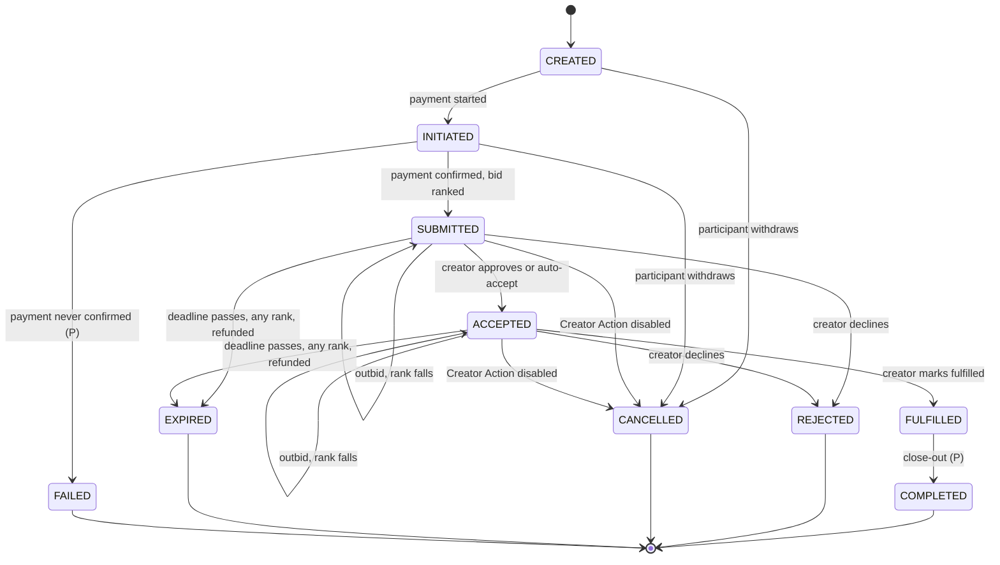

## 7. Shout-out

A participant submits a message to be displayed, read or delivered by the creator (architecture 7.5). A Shout-out can be free or paid. Its message is moderated according to the config.

### 7.1 States

`CREATED`, `INITIATED`, `SUBMITTED`, `ACCEPTED`, `FULFILLED`, `COMPLETED`, `REJECTED`, `CANCELLED`, `EXPIRED`, `FAILED`.

### 7.2 Transitions

| From | To | Trigger | Who | Preconditions | Side effects / events |
|---|---|---|---|---|---|
| (new) | `CREATED` | Participant sends the message | Participant | Creator Action is `ACTIVE`; guests allowed if the participant is a guest; message is inside the length limit; automated screening passes (decision 22); risk decision is not reject | Action and message stored; message moderation status pending |
| `CREATED` | `SUBMITTED` | Free Action is sent | System, in the same request | Config is free | `action.submitted`; creator notified |
| `CREATED` | `INITIATED` | Payment started | Participant | Config is paid; transaction limits pass; for cash: cash is enabled and no online payment is open | Online: payment `CREATED`. Cash: cash receipt reported. `action.initiated` |
| `INITIATED` | `SUBMITTED` | Payment `CONFIRMED`, or cash receipt `CASH_CONFIRMED_BY_CREATOR` | System, on the Provider's verified result; or Creator for cash | Amount and currency match | Fulfilment deadline set; receipt sent; `action.submitted` |
| `SUBMITTED` | `ACCEPTED` | Message approved: by the creator where approval is required, by moderation where the config requires it, or automatically where neither applies | Creator, Admin or System | Deadline not passed | Message moderation status approved; queue entry created; `action.accepted` |
| `SUBMITTED`, `ACCEPTED` | `REJECTED` | Creator declines, or moderation rejects the message | Creator or Admin | Not yet fulfilled | Message never shown; automatic full refund of any confirmed PSP payment (decision 22); `action.rejected` |
| `ACCEPTED` | `FULFILLED` | Creator marks it displayed, read or delivered | Creator | Deadline not passed; message approved | `fulfilled_at` and the message's display time recorded; `action.fulfilled` |
| `SUBMITTED`, `ACCEPTED` | `EXPIRED` | Fulfilment deadline passes | System (scheduled worker) | Not fulfilled | Automatic full refund of any confirmed PSP payment; `action.expired`. Idempotent |
| `SUBMITTED`, `ACCEPTED` | `CANCELLED` | The Creator Action is disabled | System, caused by Creator or Admin | Not fulfilled | Automatic full refund of any confirmed PSP payment; `action.cancelled` |
| `CREATED`, `INITIATED` | `CANCELLED` | Participant withdraws before payment is confirmed (decision 7) | Participant | No confirmed payment | Open payment expired; pending cash receipt voided; `action.cancelled` |
| `INITIATED` | `FAILED` | Payment not confirmed in time (P, DN-07) | System | As for Request | `action.failed` |
| `FULFILLED` | `COMPLETED` | Close-out (P, DN-06) | System | As for Request | `action.completed` |

A message that is reported and taken down after fulfilment is a moderation matter on the message. It does not move the Action out of `FULFILLED` or `COMPLETED`.

### 7.3 Timeouts

The same as Request (Section 4.3). The display duration in the config is a display setting, not a state timeout.

### 7.4 Terminal states

`COMPLETED`, `REJECTED`, `CANCELLED`, `EXPIRED`, `FAILED`.

### 7.5 Diagram

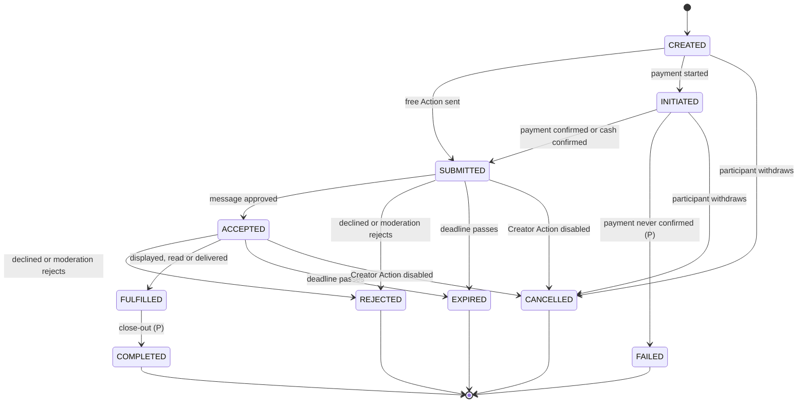

## 8. Tip

"Thank you." A voluntary amount with nothing owed in return (architecture 7.7).

A Tip has **no fulfilment step**. It is complete when its payment is confirmed. The fulfilment deadline and the automatic refund do not apply. A Tip still passes through the settlement cool-off and the transaction limits and risk controls.

### 8.1 States

`CREATED`, `INITIATED`, `COMPLETED`, `CANCELLED`, `FAILED`.

`SUBMITTED`, `ACCEPTED`, `FULFILLED`, `REJECTED` and `EXPIRED` are not used.

### 8.2 Transitions

| From | To | Trigger | Who | Preconditions | Side effects / events |
|---|---|---|---|---|---|
| (new) | `CREATED` | Participant chooses an amount | Participant | Creator Action is `ACTIVE`; guests allowed if the participant is a guest; amount is inside the configured minimum and maximum; an optional message is inside the length limit; risk decision is not reject | Action stored |
| `CREATED` | `INITIATED` | Payment started | Participant | Transaction limits pass; for cash: the profile is self-managed, cash is enabled and no online payment is open (architecture 7.7, 12.5.3) | Online: payment `CREATED`. Cash: cash receipt `CASH_REPORTED_PENDING_CREATOR_CONFIRMATION`. `action.initiated` |
| `INITIATED` | `COMPLETED` | Payment `CONFIRMED`, or cash receipt `CASH_CONFIRMED_BY_CREATOR` | System, on the Provider's verified result; or Creator for cash | Amount and currency match | Receipt sent; creator notified; `action.completed`. For a PSP payment the settlement cool-off starts (Section 11). For cash there is no settlement |
| `CREATED`, `INITIATED` | `CANCELLED` | Participant withdraws before payment is confirmed (decision 7) | Participant | No confirmed payment | Open payment expired; pending cash receipt voided; `action.cancelled` |
| `INITIATED` | `FAILED` | Payment not confirmed in time (P, DN-07) | System | The last payment is `FAILED` or `EXPIRED` and the checkout window has closed; or the cash confirmation window has closed | `action.failed` |

A Tip's optional message follows the config's moderation rule. If the message is rejected, the message is hidden and the Tip stays `COMPLETED` (P, DN-21).

A refund or dispute of a Tip is possible through the payment machine (Section 9). It does not change the Tip's state.

### 8.3 Timeouts

- Checkout window, or cash confirmation window: `INITIATED → FAILED`.
- No fulfilment deadline.

### 8.4 Terminal states

`COMPLETED`, `CANCELLED`, `FAILED`.

### 8.5 Diagram

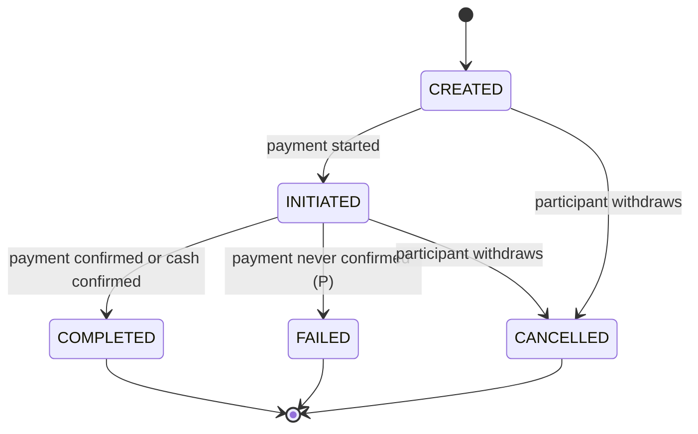

## 9. Payment

Source: architecture 13.3 and 62.7; TIS 9.1.1. This machine covers PSP-collected payments only. Cash is Section 10.

### 9.1 States

Main path: `CREATED → PENDING → CONFIRMED`.

Exception states: `FAILED`, `EXPIRED`, `REFUNDED`, `DISPUTED`, `REVERSED`.

There is no authorise/capture pair, because card holds are not used. Provider-specific states map onto these names.

| State | Meaning |
|---|---|
| `CREATED` | FAKA has recorded the intent to charge. Nothing has been sent to the payer's bank. |
| `PENDING` | The payer has been handed to the provider. The outcome is not yet known. |
| `CONFIRMED` | FAKA has verified with the provider that the money was collected. |
| `FAILED` | The provider reported that the payment did not succeed. |
| `EXPIRED` | The checkout window closed with no payment. |
| `REFUNDED` | The full amount has been returned to the payer. |
| `DISPUTED` | The payer's bank or the provider has opened a dispute or chargeback. |
| `REVERSED` | The provider has taken the money back (P for the exact meaning, DN-22). |

### 9.2 Transitions

| From | To | Trigger | Who | Preconditions | Side effects / events |
|---|---|---|---|---|---|
| (new) | `CREATED` | Checkout started | Participant | The Action is `CREATED` or `INITIATED`, or it is a ranked bid being raised; no other payment of this Action is `CREATED` or `PENDING`; no cash receipt is pending for it; transaction limits pass; risk decision is allow | Intent stored with an idempotency key and an expiry time; Action moves to `INITIATED` if it was `CREATED` |
| `CREATED` | `PENDING` | Provider accepts the initiation | System | Provider reference received | Provider reference stored; `payment.pending` |
| `CREATED` | `FAILED` | Provider refuses the initiation | Provider | None | Failure code stored; `payment.failed` |
| `CREATED`, `PENDING` | `EXPIRED` | Checkout window closes | System (scheduled worker) | For `PENDING`: a server-to-server query shows the payment was not made. An unknown outcome is queried, not assumed | `payment.expired` |
| `PENDING` | `CONFIRMED` | Verified success | Provider (authenticated webhook or server query) | Signature valid or server query successful; amount and currency match the intent; not already `CONFIRMED` | In one transaction: fees assessed; ledger entries posted (`ACTION_PAYMENT`, `PAYMENT_PROCESSING_FEE`, `PLATFORM_FEE`); settlement created as `ENTITLEMENT_RECORDED`; cool-off end time set; the Action transition in Sections 4 to 8 applied; a referral reward created as pending where the platform fee is above zero and the attribution window is open. `payment.confirmed`; receipt naming the creator paid |
| `PENDING` | `FAILED` | Verified failure | Provider | None | `payment.failed`. The participant may start a new payment while the Action is `INITIATED` |
| `CONFIRMED` | `REFUNDED` | Refund succeeded at the provider | Provider confirms; the refund itself is started by System (automatic refund) or Admin (support decision) | A refund record exists for the full amount; the total refunded does not exceed the payment | Ledger: `ACTION_REFUND`, `PLATFORM_FEE` reversal, `PAYMENT_PROCESSING_FEE` reversal where the provider returns it. Settlement moves to `CANCELLED` if not yet settled; otherwise a negative creator entitlement is recorded (Section 11). Referral reward reversed. `payment.refunded` |
| `CONFIRMED` | `DISPUTED` | Provider reports a dispute or chargeback | Provider | None | Dispute record created; settlement moves to `SETTLEMENT_HELD` if not yet settled; operator alert; `payment.disputed` |
| `DISPUTED` | `CONFIRMED` | Dispute decided for the creator (P, DN-22) | Provider | None | Dispute closed as won; settlement hold released; `payment.dispute_resolved` |
| `DISPUTED` | `REVERSED` | Dispute decided for the payer (P, DN-22) | Provider | None | Dispute closed as lost. Ledger entries reverse the payment and the platform fee; the amount is charged to the creator: first against funds in the cool-off, then as a negative creator entitlement (architecture 13.1.1). Settlement `CANCELLED` if not yet settled. Referral reward reversed. `payment.reversed` |
| `CONFIRMED` | `REVERSED` | Provider reverses the payment without a dispute (P, DN-22) | Provider | None | Same financial effects as a lost dispute. `payment.reversed` |
| `EXPIRED`, `FAILED` | `CONFIRMED` | Verified success arrives late (P, DN-25) | Provider | Signature valid or server query successful; amounts match | All the effects of `PENDING → CONFIRMED`. If the Action is already terminal, an automatic full refund follows at once (P, DN-10) |

Notes:

- **A refund in progress is not a payment state.** The payment stays `CONFIRMED` until the provider confirms the refund. Progress is on the refund record (requested, approved, submitted, succeeded or failed, reconciled; TIS 9.6). A failed refund leaves the payment `CONFIRMED` and raises a reconciliation exception (P, DN-23).
- **MVP1 has no partial refund.** A refund is always for the full amount of the payment, so `REFUNDED` means the full amount (decision 8). Automatic refunds are always full (architecture 8.1).
- A duplicate webhook is recognised by its provider event ID and does nothing.

### 9.3 Timeouts

| Timeout | Result |
|---|---|
| Checkout window (`expires_at`) | `CREATED` or `PENDING` → `EXPIRED`, after a provider query for `PENDING`. Its length is not defined (P, DN-26) |
| Cool-off | Not a payment transition. It gates settlement (Section 11) |

### 9.4 Terminal states

`FAILED` and `EXPIRED` (unless a late verified success arrives, DN-25), `REFUNDED`, `REVERSED`.

`CONFIRMED` is a resting state, not a terminal one: a refund, dispute or reversal can still follow. The platform must not promise that a refund becomes impossible once the cool-off has passed (architecture 13.5).

### 9.5 Diagram

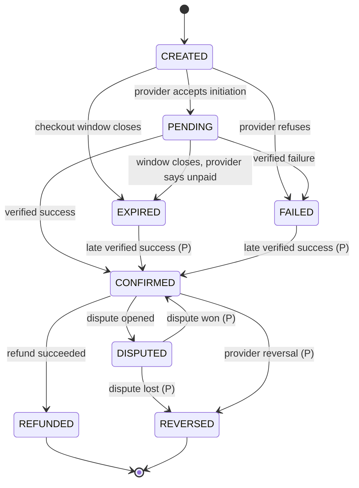

## 10. Cash receipt

Source: architecture 12.5.3, 13.3, 13.4.1 and 62.2; TIS 9.4.

Cash paid in person is a direct payment from the customer to the creator. FAKA does not collect it, hold it or settle it. The cash receipt is the creator's attestation. It is not a PSP payment and it creates no payment intent.

### 10.1 States

| State | Corresponds to | Meaning |
|---|---|---|
| `CASH_REPORTED_PENDING_CREATOR_CONFIRMATION` | Payment `PENDING` | The customer has said they are paying cash. Nothing is confirmed. |
| `CASH_CONFIRMED_BY_CREATOR` | Payment `CONFIRMED` | The creator has confirmed, from their own authenticated account, that they received the cash. |

There are exactly two states. The labels `PSP_PAID`, `ONLINE_PAYMENT_CONFIRMED` and `FAKA_SETTLED` are never used for cash.

### 10.2 Transitions

| From | To | Trigger | Who | Preconditions | Side effects / events |
|---|---|---|---|---|---|
| (new) | `CASH_REPORTED_PENDING_CREATOR_CONFIRMATION` | Customer chooses "cash in person" | Participant | The config has cash enabled; the profile is self-managed; cash is permitted for this Action type and country; any online payment already started for this Action has been cancelled or has expired, so the customer cannot be charged twice; the screen has stated that cash is paid directly to the creator and that FAKA does not collect it | Receipt stored with amount, currency, Action and session context; platform fee 0; processing fee 0; Action moves to `INITIATED`; creator notified. No ledger entry, no payment intent |
| `CASH_REPORTED_PENDING_CREATOR_CONFIRMATION` | `CASH_CONFIRMED_BY_CREATOR` | Creator confirms receipt | **Creator only: the authenticated member who owns the profile.** Not a manager, staff member, representative, admin or the customer | The receipt is pending and not voided; the confirming member owns the profile; amount and currency are those on the receipt; idempotency key not already used | Records the confirming creator, time, amount, currency, Action, session context and optional note. Ledger memo entry `DIRECT_CASH_RECEIPT_CONFIRMED`. The Action moves to `SUBMITTED` (a Tip moves to `COMPLETED`). `cash_receipt.confirmed` |

What confirmation does **not** do:

- It does not mark the Action fulfilled. The Action follows its own machine (architecture 12.5.3 step 7).
- It does not create a settlement, a payout, a pending balance or a referral reward.
- It does not create or imply a PSP transaction.
- It does not cause a fee to be charged on any other payment.

What is **not** confirmation: a QR scan, the customer's statement, the Action being submitted, a staff entry or an operator's claim.

### 10.3 Correction

A confirmed receipt is never edited or deleted. A wrong confirmation (wrong amount, wrong Action, cash not actually received) is corrected by a new compensating cash-receipt record that points at the original, with a reason, and a `CASH_RECEIPT_REVERSAL_OR_CORRECTION` ledger entry. The original receipt stays `CASH_CONFIRMED_BY_CREATOR` and stays visible. Who may raise a correction is a proposal (DN-28).

### 10.4 Timeouts

- Cash confirmation window (P, DN-27): if the creator has not confirmed by the end of the window, or marks the cash as not received, the Action moves to `FAILED` and the receipt is marked voided. The receipt state stays `CASH_REPORTED_PENDING_CREATOR_CONFIRMATION`, because the architecture defines only two states.
- No cool-off. No automatic refund: FAKA holds nothing to refund.

### 10.5 Terminal states

`CASH_CONFIRMED_BY_CREATOR`. A voided pending receipt is closed without changing state (P, DN-27).

### 10.6 Diagram

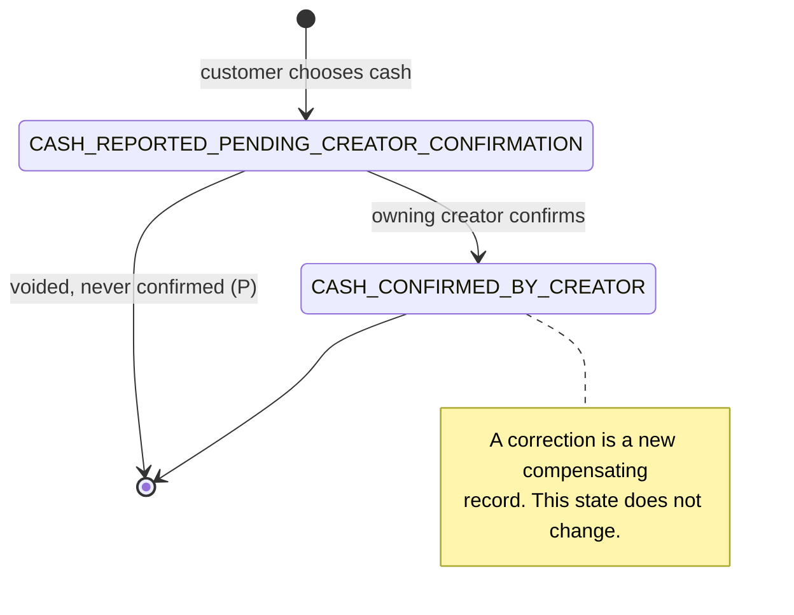

## 11. Settlement

Source: architecture 13.3 and 13.5; TIS 9.5. One settlement record is the creator's entitlement from one confirmed PSP payment (P for the granularity; domain model OQ-23).

There is no instant split to the creator at collection time.

### 11.1 States

Main path: `ENTITLEMENT_RECORDED → SETTLEMENT_ELIGIBLE → SETTLEMENT_PROCESSING → SETTLED`.

Exception states: `SETTLEMENT_HELD`, `SETTLEMENT_FAILED`, `CANCELLED` (the payment was refunded before settlement).

| State | Meaning |
|---|---|
| `ENTITLEMENT_RECORDED` | The payment is confirmed and the creator's entitlement is on the ledger. The creator sees it in the pending balance. |
| `SETTLEMENT_ELIGIBLE` | All eligibility conditions hold. Nothing has been paid yet. |
| `SETTLEMENT_PROCESSING` | A payout that includes this entitlement has been sent to the provider. |
| `SETTLED` | The provider has confirmed the payout. |
| `SETTLEMENT_HELD` | Blocked by a dispute, a risk decision or a policy hold. |
| `SETTLEMENT_FAILED` | The provider reported that the payout failed. |
| `CANCELLED` | The payment was refunded or reversed before settlement. |

### 11.2 Eligibility conditions

A settlement moves to `SETTLEMENT_ELIGIBLE` only when **all** of these are true (architecture 13.5; TIS 9.5):

1. The payment is `CONFIRMED`. It is not `DISPUTED`, `REFUNDED` or `REVERSED`.
2. The cool-off for that payment has elapsed. The cool-off is mandatory; only its length is configured.
3. The payment's Action has been fulfilled:
   - Request, Shout-out: the Action is `FULFILLED` or `COMPLETED`.
   - Bid, at any rank: the Action is `FULFILLED` or `COMPLETED`. An unfulfilled bid is never eligible.
   - Tip: on payment confirmation, because a Tip has no fulfilment step.
4. The creator has a verified Settlement Profile: its payout eligibility is `PAYOUT_ENABLED` (Section 12).
5. No risk or policy hold is in force, and reconciliation has raised no blocking exception for the payment (TIS 9.5).

The cool-off elapsing does not by itself release anything. A creator with no verified destination stays at `ENTITLEMENT_RECORDED` however long ago the cool-off ended (architecture 13.1.1).

### 11.3 Transitions

| From | To | Trigger | Who | Preconditions | Side effects / events |
|---|---|---|---|---|---|
| (new) | `ENTITLEMENT_RECORDED` | Payment `CONFIRMED` | System, in the payment-confirmation transaction | PSP payment only. Never for cash or a free Action | Gross, processing fee, platform fee and net entitlement recorded; cool-off end time set; creator is prompted to set up settlement details when they first have a pending balance (architecture 13.1.1); `settlement.entitlement_recorded` |
| `ENTITLEMENT_RECORDED` | `SETTLEMENT_ELIGIBLE` | Eligibility check passes | System (scheduled worker, and re-checked when the Action is fulfilled, the cool-off ends or the profile becomes `PAYOUT_ENABLED`) | All five conditions in 11.2 | Settlement Profile recorded on the settlement; `settlement.eligible` |
| `ENTITLEMENT_RECORDED`, `SETTLEMENT_ELIGIBLE` | `SETTLEMENT_HELD` | Payment becomes `DISPUTED`; or a risk or policy hold is placed; or the profile becomes `PAYOUT_SUSPENDED` after eligibility (P, DN-30) | System or Admin | None | Hold reason recorded; `settlement.held` |
| `SETTLEMENT_HELD` | `ENTITLEMENT_RECORDED` | Hold lifted (P, DN-29) | System (dispute won) or Admin (review cleared) | The cause of the hold is resolved | The eligibility check runs again from the start; `settlement.hold_released` |
| `ENTITLEMENT_RECORDED`, `SETTLEMENT_ELIGIBLE`, `SETTLEMENT_HELD` | `CANCELLED` | Payment becomes `REFUNDED` or `REVERSED` before settlement | System, in the refund or reversal transaction | None | Entitlement reversed on the ledger; `settlement.cancelled` |
| `SETTLEMENT_ELIGIBLE` | `SETTLEMENT_PROCESSING` | Payout initiated with the provider | System | Conditions in 11.2 still hold at that moment; the profile is still `PAYOUT_ENABLED`; any negative creator entitlement has been netted (P, domain model OQ-25) | Payout transaction created with an idempotency key; `settlement.processing` |
| `SETTLEMENT_PROCESSING` | `SETTLED` | Provider confirms the payout | Provider | Amount and currency match | Ledger: `ACTION_SETTLEMENT` and `CREATOR_PAYOUT`; `settlement.settled`; creator notified |
| `SETTLEMENT_PROCESSING` | `SETTLEMENT_FAILED` | Provider reports the payout failed | Provider | None | Failure code recorded; reconciliation exception; `settlement.failed` |
| `SETTLEMENT_FAILED` | `SETTLEMENT_ELIGIBLE` | Retry allowed (P, DN-31) | System or Admin | The provider outcome is known to be a failure, not unknown; the cause is fixed; conditions in 11.2 still hold | `settlement.eligible` |
| `SETTLEMENT_FAILED` | `SETTLEMENT_HELD` | The failure needs review (P, DN-31) | Admin | None | `settlement.held` |

Refund or chargeback **after** `SETTLED`, or while `SETTLEMENT_PROCESSING`: the settlement state does not change. The amount is charged to the creator as a negative creator entitlement on the ledger and recovered from later collections (architecture 13.1.1; P for the processing case, DN-32). FAKA does not advance its own money by default.

### 11.4 Timeouts

- Cool-off end: makes condition 2 true. It triggers a check, not a release.
- No timeout moves a settlement to `SETTLED`.
- Funds held for a creator who never sets up settlement details: undefined in the architecture (DN-33).

### 11.5 Terminal states

`SETTLED`, `CANCELLED`.

### 11.6 Diagram

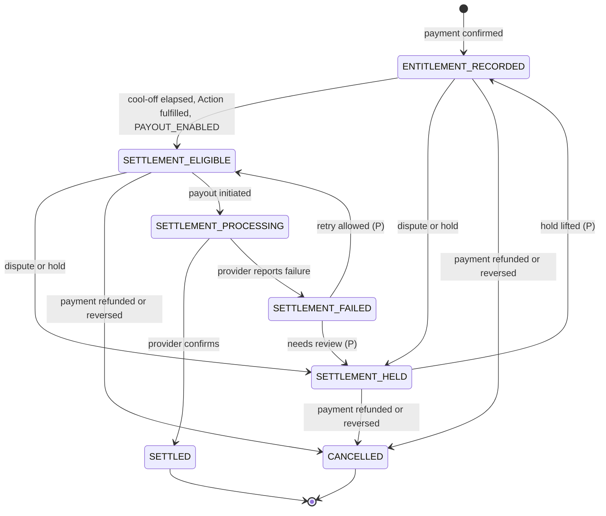

## 12. Payout eligibility on the Settlement Profile

Source: architecture 62.3 (the state set is shared with 62.1.1); TIS 9.1.1.

A Settlement Profile belongs to a member. A creator needs one to be paid out. Any member needs one to receive an approved referral reward (architecture 15.4). It is not needed to create a profile, publish free Actions, take paid Actions or accept cash.

### 12.1 States

| State | Meaning | Used in MVP1 |
|---|---|---|
| `DESTINATION_PENDING` | No payout destination has been given yet. | Yes |
| `VERIFICATION_PENDING` | A destination has been given and is being verified by the provider. | Yes |
| `PAYOUT_ENABLED` | The payee and destination are verified. Payout is allowed. | Yes |
| `PAYOUT_SUSPENDED` | Payout is blocked after having been set up. | Yes |
| `NO_ELIGIBLE_PAYEE` | There is no verified eligible payee for the profile. | Reserved for managed profiles (P, DN-35) |
| `NOT_APPLICABLE` | Payout does not apply. | Reserved (P, DN-35) |

The architecture gives one path: `DESTINATION_PENDING → VERIFICATION_PENDING → PAYOUT_ENABLED`. Every other transition below is a proposal.

### 12.2 Transitions

| From | To | Trigger | Who | Preconditions | Side effects / events |
|---|---|---|---|---|---|
| (new) | `DESTINATION_PENDING` | Member starts setting up settlement details (P, DN-34) | Member | Authenticated member | Profile created; `settlement_profile.created` |
| `DESTINATION_PENDING` | `VERIFICATION_PENDING` | Destination submitted | Member | The rail is supported in the country; step-up verification passed; the destination is passed to the provider, and no PSP secret is collected from the member | Provider onboarding started; audit log entry; `settlement_profile.verification_started` |
| `VERIFICATION_PENDING` | `PAYOUT_ENABLED` | Provider confirms payee and destination | Provider | The KYC required by the provider, country and risk level is complete (architecture 62.4) | `verified_at` set; pending settlements are re-checked for eligibility; approved referral rewards become payable; `settlement_profile.payout_enabled`; member notified |
| `VERIFICATION_PENDING` | `DESTINATION_PENDING` | Verification fails or is rejected (P, DN-36) | Provider | None | Reason recorded; member asked to correct the details; `settlement_profile.verification_failed` |
| `PAYOUT_ENABLED` | `VERIFICATION_PENDING` | Member changes the destination (P, DN-36) | Member | Step-up verification passed | Audit log entry; payouts stop until the new destination is verified; settlements that were `SETTLEMENT_ELIGIBLE` are held (Section 11); `settlement_profile.destination_changed` |
| `PAYOUT_ENABLED` | `PAYOUT_SUSPENDED` | Risk decision, provider suspension, expired verification, or account suspension (P, DN-36) | System, Provider or Admin | A reason is recorded | Eligible settlements move to `SETTLEMENT_HELD`; `settlement_profile.payout_suspended`; member notified |
| `PAYOUT_SUSPENDED` | `PAYOUT_ENABLED` | Suspension lifted (P, DN-36) | Provider or Admin | The cause is resolved; the destination is unchanged and still verified | Held settlements are re-checked; `settlement_profile.payout_enabled` |
| `PAYOUT_SUSPENDED` | `VERIFICATION_PENDING` | Re-verification required (P, DN-36) | Provider or Admin | None | `settlement_profile.verification_started` |

A balance or ledger entitlement must never be described as withdrawable in any state other than `PAYOUT_ENABLED`, and even then only for amounts that have passed the checks in Section 11 (architecture 62.3).

### 12.3 Timeouts

None defined by the architecture. A provider verification that expires is handled as a suspension (P, DN-36).

### 12.4 Terminal states

None. A profile can always be changed or re-verified.

### 12.5 Diagram

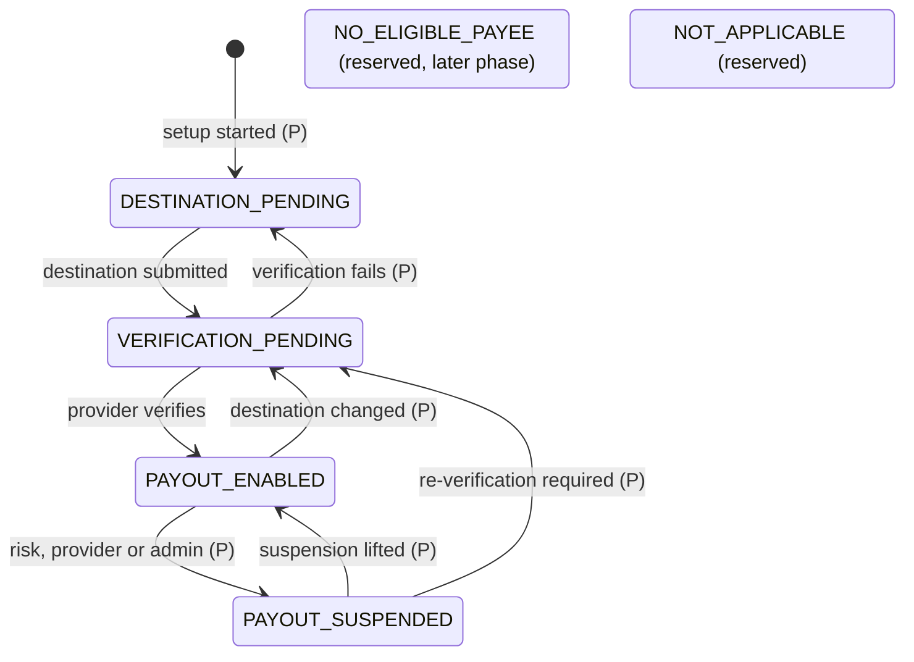

## 13. Referral reward

Source: architecture 14.2, 15 and 37; TIS 9.6.1.

The architecture describes a reward as pending, approved, paid, reversed or expired. It does not give canonical capitalised names; the names below are a proposal (DN-37).

### 13.1 States

| State | Meaning |
|---|---|
| `PENDING` | A potential reward. It has not yet met the qualification, fraud and reversal conditions (architecture 14.2 "pending reward"). |
| `APPROVED` | A reward entitlement under the programme rules. Not yet paid. It has an expiry date. |
| `PAID` | Paid by the provider to the member's verified Settlement Profile. |
| `REVERSED` | Taken back because the payment was refunded or charged back, or because of fraud. |
| `EXPIRED` | Approved, and the member has had no verified settlement details for 12 months after the approval date (decision 5). |

### 13.2 When a reward is created

A reward is created as `PENDING` when a PSP payment is `CONFIRMED` and all of these are true:

- the payment was received by a creator who was referred: the member who owns the recipient creator profile has an active referral attribution, and the payment is inside its 12-month window. Payments a referred member makes do not earn a reward (decision 4);
- the platform fee on the payment is greater than zero.

No reward is created while the platform fee is zero (for example during the launch fee programme) or for cash paid in person, and the 12-month window is not extended to make up for it (architecture 15.1). The reward is a configured share of the platform fee. The PSP processing fee does not reduce it.

### 13.3 Transitions

| From | To | Trigger | Who | Preconditions | Side effects / events |
|---|---|---|---|---|---|
| (new) | `PENDING` | Qualifying payment `CONFIRMED` | System, in the payment-confirmation transaction | The conditions in 13.2; not a self-referral; the reward cap is not exceeded | Reward recorded; `referral_reward.pending`; referrer can see it as pending |
| `PENDING` | `APPROVED` | Qualification and pending periods end | System; Admin where a fraud flag needs review | The source payment is still `CONFIRMED`; its cool-off has ended (P, DN-38); no open fraud flag | Ledger: `REFERRAL_REWARD` (P for the timing, DN-38); expiry date set to 12 months after approval; `referral_reward.approved`; if the member has no verified settlement details, they are prompted to set them up |
| `PENDING` | `REVERSED` | Source payment `REFUNDED` or `REVERSED`; or fraud confirmed (P, DN-39) | System or Admin | None | Reversal record; `referral_reward.reversed` |
| `APPROVED` | `PAID` | Provider confirms the reward payout | Provider; payout initiated by System | The member's Settlement Profile is `PAYOUT_ENABLED`; the member's approved total is at least the minimum payout; no open fraud flag | Payout transaction linked; ledger payout entry; `referral_reward.paid`; member notified |
| `APPROVED` | `REVERSED` | Source payment `REFUNDED` or `REVERSED`; or fraud confirmed | System or Admin | None | Reversal record; ledger: `REFERRAL_REVERSAL`; `referral_reward.reversed` |
| `APPROVED` | `EXPIRED` | Expiry date passes | System (scheduled worker) | The member has had no verified settlement details for the 12 months since the reward's approval date (decision 5; architecture 15.4); the member was reminded before the date. A reward owed to a member with verified settlement details does not expire, whatever the reason it is still unpaid, for example being below the minimum payout | Ledger: `REFERRAL_EXPIRY` as a compensating entry; the original entry is not altered; `referral_reward.expired`. Not reinstated |
| `PAID` | `REVERSED` | Source payment `REFUNDED` or `REVERSED` after the reward was paid (P, DN-41) | System | None | Reversal record; ledger: `REFERRAL_REVERSAL`; the amount is netted against the member's later rewards. `referral_reward.reversed` |

Rules that hold in every state: a reward is never a spendable balance, cannot pay for an Action and cannot be transferred to another member (architecture 15.4).

### 13.4 Timeouts

| Timeout | Result |
|---|---|
| Qualification / pending period (configurable) | `PENDING → APPROVED` |
| Expiry: 12 months after approval, per reward | `APPROVED → EXPIRED`, only if the member has had no verified settlement details in that time (decision 5). Otherwise the reward stays `APPROVED` |
| Reminder before expiry | Notification only |
| Attribution window: 12 months | After it, no new rewards are created. Existing rewards are not affected |

### 13.5 Terminal states

`REVERSED`, `EXPIRED`. `PAID` is terminal unless a later refund or chargeback reverses it (DN-41).

### 13.6 Diagram

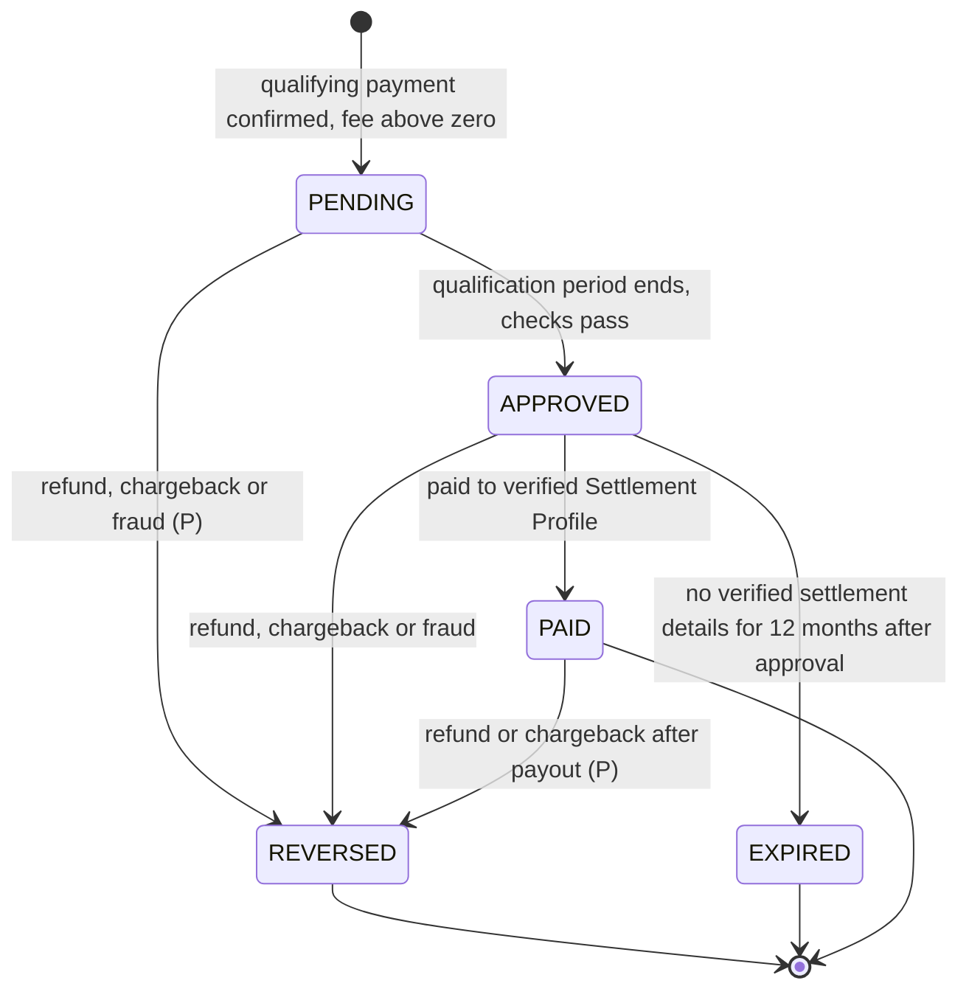

## 14. QR resource

Source: architecture 9 and 62.8.

The architecture names the lifecycle controls: generation, activation, suspension, expiry, revocation and replacement. It does not name the states. The state names below are a proposal (DN-42).

A printed code holds only a short opaque identifier. The backend decides where it leads and whether it works. A code is never enough authority for a financial operation.

### 14.1 States

| State (P) | Meaning |
|---|---|
| `GENERATED` | The code exists. It does not resolve yet. |
| `ACTIVE` | The code resolves and redirects to its current destination. |
| `SUSPENDED` | Temporarily not resolving. |
| `EXPIRED` | A temporary code whose time has passed. |
| `REVOKED` | Permanently withdrawn, for example because it was compromised. |
| `REPLACED` | Superseded by another code. |

### 14.2 Transitions

| From | To | Trigger | Who | Preconditions | Side effects / events |
|---|---|---|---|---|---|
| (new) | `GENERATED` | Generation | Creator; or System (Starter Pack) | The target belongs to the creator's profile | Unique short code issued; `qr_resource.generated` |
| `GENERATED` | `ACTIVE` | Activation | Creator; or System when the target is published | The target exists and is public | `qr_resource.activated` |
| `ACTIVE` | `SUSPENDED` | Suspension | Creator or Admin | None | Scans show a neutral page (P, DN-43); `qr_resource.suspended` |
| `SUSPENDED` | `ACTIVE` | Reinstatement | Whoever suspended it; Admin for a platform suspension | The target is still valid | `qr_resource.activated` |
| `ACTIVE`, `SUSPENDED` | `EXPIRED` | Expiry time passes | System | `expires_at` is set | `qr_resource.expired` |
| `EXPIRED` | `ACTIVE` | Creator sets a later expiry (P, DN-44) | Creator | The target is still valid | `qr_resource.activated` |
| `GENERATED`, `ACTIVE`, `SUSPENDED`, `EXPIRED` | `REVOKED` | Revocation | Creator or Admin | A reason is recorded | The code never resolves again and is never reissued; `qr_resource.revoked` |
| `ACTIVE`, `SUSPENDED` | `REPLACED` | Replacement | Creator or Admin | A successor code exists and is `ACTIVE` | Link to the successor recorded; `qr_resource.replaced`. What the old code then does is DN-45 |

**Retargeting is not a state change.** While a code is `ACTIVE`, its destination can change: a handle rename, a different Action, a different session. The printed code keeps working, which is the purpose of the opaque identifier (architecture 9).

Resolution rule: an `ACTIVE` code redirects to its current destination. A `REPLACED` code follows DN-45. Every other state shows a neutral page that starts no payment (P, DN-43).

### 14.3 Timeouts

- `expires_at`: `→ EXPIRED`.

### 14.4 Terminal states

`REVOKED`, `REPLACED`.

### 14.5 Diagram

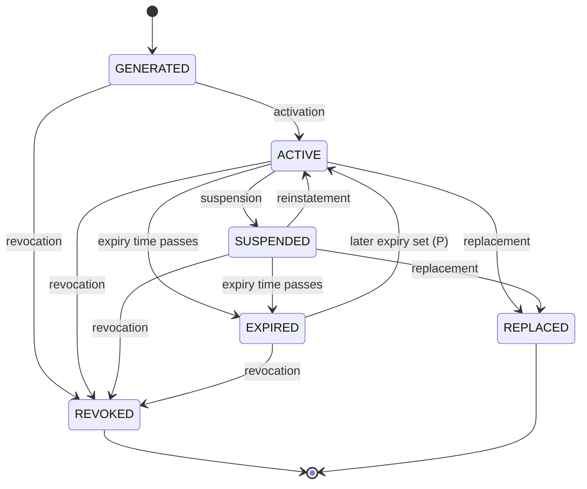

## 15. How the machines link

This table shows which machine causes a change in which other. Each cause and its effects are written in one database transaction where the effect is inside FAKA, and through the outbox where the effect needs the provider.

| Cause | Effect on Action | Effect on Payment | Effect on Settlement | Effect on Referral reward |
|---|---|---|---|---|
| Payment `CONFIRMED` | Request, Shout-out: `SUBMITTED`. Bid: `SUBMITTED` and ranked, or a raise applied. Tip: `COMPLETED` | — | `ENTITLEMENT_RECORDED` created | `PENDING` created if the fee is above zero and the window is open |
| Cash receipt `CASH_CONFIRMED_BY_CREATOR` | Request, Shout-out: `SUBMITTED`. Tip: `COMPLETED` | None. No payment exists | None | None |
| Action `FULFILLED` | — | None | Eligibility check runs | None |
| Action `REJECTED`, `EXPIRED` or `CANCELLED` with a confirmed PSP payment | Stays as it is | Refund started; `REFUNDED` when the provider confirms | `CANCELLED` | `REVERSED` |
| Action `REJECTED`, `EXPIRED` or `CANCELLED`, cash-paid | Stays as it is | None | None | None |
| Bid outbid | Rank changes; state unchanged | **None. No refund** | None | None |
| Payment `DISPUTED` | **None** | — | `SETTLEMENT_HELD` | None until the dispute is decided |
| Payment `REFUNDED` or `REVERSED` after the Action is `FULFILLED` or `COMPLETED` | **None.** The Action keeps its state | — | `CANCELLED`, or a negative creator entitlement if already settled | `REVERSED` |
| Settlement Profile becomes `PAYOUT_ENABLED` | None | None | Eligibility check runs for every `ENTITLEMENT_RECORDED` settlement of the member | Approved rewards become payable |
| Creator Action `DISABLED` | Every unfulfilled paid Action: `CANCELLED` (decision 6). Free Actions too (decision 18) | Every confirmed PSP payment of those Actions is refunded in full | `CANCELLED` | `REVERSED` |

Statements that must hold at all times:

1. An Action is never in a refund or dispute state.
2. A `CONFIRMED` payment does not prove the Action was fulfilled. A `COMPLETED` Action does not prove the funds have settled (TIS 8.2).
3. A cash receipt never has a payment, a settlement, a payout or a referral reward.
4. No settlement is `SETTLEMENT_ELIGIBLE` or later unless its Action is fulfilled, its cool-off has elapsed and the Settlement Profile is `PAYOUT_ENABLED`.
5. Being outbid changes only a bid's rank.
6. A participant cannot cancel an Action after its payment is confirmed (decision 7).
7. Every refund is for the full amount of its payment (decision 8).

## 16. Decisions needed

The list of transitions and rules the architecture leaves undefined, with their proposed defaults, is kept in the private repository and is not published. Rows marked (P) above are proposals; `DN-` numbers refer to that list.

## 17. As built in `api-symfony` (recorded 2026-10-15)

Facts about the reference implementation, from its code and commit history. They are not test results on production infrastructure. Where the implementation differs from this file, the difference is stated; neither side is silently changed.

| Machine | What is built | Difference from this file |
|---|---|---|
| Creator Action (Section 2) | All states. Publish moves `DRAFT → PUBLISHED` and on to `ACTIVE` when there is no start time or it has passed (decision 17). Resume, and reopening an `EXPIRED` one by moving its end time, are built (DN-02 proposals). Disable cancels paid and free unfulfilled Actions (decisions 6, 18). A scheduled command opens and closes Creator Actions on time. | No re-enable of a `DISABLED` Creator Action (DN-02 proposes one). The admin "disable action" moderation decision is not built. Creating a Creator Action is refused while the creator's country is not active. |
| Participant Action (Sections 3 to 7), free path | Free Request, Vote and Shout-out: `CREATED → SUBMITTED`, accept, reject, fulfil, expire at the deadline, cancel on disable; votes complete when voting closes (decision 20). Free Actions get a deadline (decision 24). | A vote over the limit is refused with `409 PARTICIPATION_LIMIT_REACHED` and **no** `REJECTED` Action is stored (contract item 59), unlike the `CREATED → REJECTED` row in Section 5.2. Paid submissions go through the payment path (Paystack sandbox, decision 25); without an active gateway account they are refused with `503 PAYMENT_PROVIDER_UNAVAILABLE`. |
| Shout-out message | Screening before submission behind an interface (decision 22). Moderation can hide a message after the fact (`action_messages.hidden_at`, `ActionMessageHidden`). | Hiding is a flag on the message, not a moderation status; the Action keeps its state, as Section 7.2 says. |
| QR resource (Section 14) | `GENERATED`, `ACTIVE`, `SUSPENDED`, `REVOKED`, `REPLACED`, with reinstatement and replacement (DN-42, DN-45 proposals). One active code is issued when a member becomes a creator. A replaced code resolves as its successor, at most ten hops and only within the same creator. | `EXPIRED` is not stored: it is computed when a code is resolved from `expires_at`, so no `QrResourceExpired` event is emitted. A creator can withdraw a working code and get a new one, but never replace one FAKA iAction suspended; moderation can suspend or revoke a code. |
| Payment, cash, settlement, payout eligibility, referral reward (Sections 9 to 13) | Payments in the Paystack sandbox with automatic refunds and reconciliation; cash paid in person (reported, confirmed, voided, corrected); payout eligibility of the Settlement Profile and payouts by transfer, behind the legal gate of decision 26 (as of 2026-10-24). | Where Section 11 differs from decision 26, decision 26 applies. Disputes have no workflow: a reversal is recorded and listed for operators. Referral rewards are not built (ADR-009). |

Versions kept by the implementation. Every machine above records each transition in `state_transitions` with `entity_version`. Creator Actions and participant Actions also carry `state_version` and a separate optimistic-lock column `lock_version`, which changes on every update, not only on transitions. The event `aggregateVersion` is a third, independent sequence kept in the outbox (`../events/README.md`, "Aggregate version as built").
